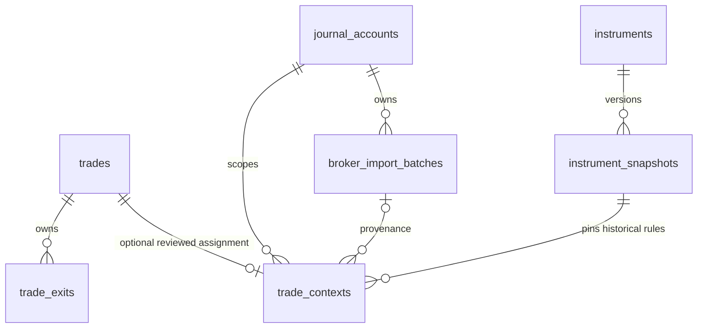

# Phase 2B.2 — Additive persistence and migration rehearsals

Status: code and disposable SQLite rehearsals completed. **Normal journal migration is not authorized and has not been run.** Remote pushes and deployment also remain unapproved. This milestone adds persistence foundations, not account-management screens, CFD entry/calculators, statement import or broker connections.

## Database design in plain language

A table is a collection of one kind of record. A primary key is its permanent record ID. A foreign key is a checked reference to another record. A schema is the collection of tables and rules; an Alembic migration is a versioned change to that collection.

The existing schema at revision `0002` has:

| Table              | Meaning                                                        | Migration 0003 behavior                             |
| ------------------ | -------------------------------------------------------------- | --------------------------------------------------- |
| `trading_accounts` | Legacy currency-level opening balances                         | Untouched; not treated as verified broker accounts  |
| `trades`           | Journal records, original IDs, notes and screenshot references | Untouched; no table rebuild or automatic assignment |
| `trade_exits`      | Partial exits linked to trades                                 | Untouched; original IDs and links retained          |
| `alembic_version`  | Installed migration revision                                   | Advances only in the database explicitly migrated   |

Five additive tables are introduced:

| Table                   | Purpose                                                                                                                       |
| ----------------------- | ----------------------------------------------------------------------------------------------------------------------------- |
| `journal_accounts`      | Explicit account ID, broker, platform/server, optional non-secret broker account reference, reporting and settlement currency |
| `instruments`           | Stable instrument ID, broker/venue, symbol, market category and product                                                       |
| `instrument_snapshots`  | Versioned validated specification JSON, content fingerprint and creation time                                                 |
| `broker_import_batches` | Account-scoped source fingerprint, source kind and adapter version for future imports                                         |
| `trade_contexts`        | Optional explicit association of an existing trade with an account, instrument snapshot and optional import batch             |



An old trade without a context row is unassigned. The migration creates zero accounts, instruments, snapshots, batches or contexts. It does not infer ownership from an exchange label, currency or symbol. Future account balances/cash flows and risk settings belong to 2B.3; legacy balance buckets are not automatically moved or duplicated.

## Database and application safeguards

- Composite foreign keys bind a context to the same broker and settlement currency on its account and snapshot. Snapshots must refer to the declared instrument; import batches must belong to the context's account. References to missing records fail.
- Deleting a used account is restricted. Deleting a trade cascades only its exits/context; snapshots remain preserved. Existing screenshot handling stays in the journal service and is not changed by this migration.
- Product/category checks distinguish crypto from CFD/TradFi products. Known broker account references are unique within broker/platform/server scope; unknown references remain unknown. A partial unique index handles accounts whose server is null without inventing a server value.
- SQLite foreign keys are enabled on SQLAlchemy connections. This fixes SQLite's default lack of enforcement; PostgreSQL enforces foreign keys natively. Direct SQLite tools must enable their own foreign-key checks too.
- Database triggers reject snapshot updates and deletes, including SQLite `INSERT OR REPLACE` attempts. PostgreSQL also has a truncate guard. New broker specifications append a new snapshot ID; they do not replace old trade rules. Snapshot fingerprints and schema validation are verified on application reads.
- Snapshot JSON preserves Decimal amounts as strings and source/effective/capture timestamps from the 2B.1 contract. Application validation checks semantic financial fields; database constraints enforce structural identity and relationships. These are complementary safeguards, not a claim that arbitrary direct SQL has full Pydantic validation. Database administrators can alter/drop guards; this is protection against accidental application writes, not a substitute for access control.
- Persistence helpers do not commit transactions or infer account assignments. Callers use an explicit session transaction. The reviewed legacy-assignment helper validates recorded symbol, broker, currency and crypto product, and refuses implicit reassignment. It is not exposed as a public API or UI in this milestone.
- Existing journal handlers/calculators are unchanged and still operate at schema `0002`. New persistence helpers require `0003`. Readiness continues checking the existing journal schema, not claiming the multi-asset extension is installed. No new form accepts CFDs yet.

Snapshots protect historical rules independently of current instrument metadata. Instrument identity changes are refused by the persistence service; an inconsistent direct SQL edit is detected when loading the snapshot. The future account/trade API must use these validators and explicitly handle identity changes before exposing assignment/editing controls.

## Migration transaction and downgrade policy

Migration `0003` creates new tables/indexes/guards only. It does not issue updates or alterations against legacy journal tables.

SQLite's Python driver may not automatically put DDL (table-changing statements) in a transaction. Alembic now begins an explicit transaction for SQLite, including supplied legacy-mode connections. Tests inject failures after early and late DDL and verify that new tables, triggers and the version change roll back while legacy content remains unchanged. PostgreSQL uses native transactional DDL. Rehearsals use explicitly supplied connections so they cannot accidentally fall back to the personal `DATABASE_URL`.

Downgrade to `0002` is allowed only while **all five extension tables are empty**. If any new data exists, downgrade raises before dropping anything. Do not delete snapshots to force a downgrade. A reviewed backup restoration or a deliberate future data-preserving migration is required instead.

## Disposable rehearsal and backup

The runner creates a fresh temporary directory; it has no database URL option. It installs actual revisions `0001` and `0002`, seeds four synthetic trades (closed spot, short linear futures, partial linear futures and an open USDT trade), three exits, a legacy opening balance and a PNG screenshot. It then:

1. Captures complete legacy rows, IDs, calculated metrics, exit links and screenshot fingerprints.
2. Uses SQLite's backup API to create `before-0003.db`, then copies the synthetic uploads directory.
3. Runs migration `0003`, compares legacy state and verifies all new tables are empty.
4. Runs Alembic metadata comparison (`command.check`).
5. Tests safe empty-extension downgrade and re-upgrade.
6. Reports the result and removes its temporary database, backup and screenshot files on exit.

Separate tests restore the backup into another disposable location and verify the original `0002` schema, rows, metrics and screenshot bytes. They also prove rollback after injected failures and refusal of a populated downgrade. These backups are **synthetic rehearsal backups**, not a backup of the owner's normal journal.

From the repository root, safely repeat the rehearsal:

```powershell
.\.venv\Scripts\python.exe services/api/scripts/rehearse_multi_asset.py
.\.venv\Scripts\python.exe -m pytest services/api/tests/test_multi_asset_migrations.py services/api/tests/test_multi_asset_persistence.py -v
```

Expected summary: four trades, three exits, preserved legacy state, zero rows in all five extension tables, metadata check passed and safe empty-extension downgrade/re-upgrade passed. Synthetic numbers are teaching fixtures, not prices or broker statements.

**Do not run `alembic upgrade head` against the normal journal yet.** Its migration requires explicit owner approval after reviewing this report. Before a later approved migration: stop writers, verify the resolved database/upload paths, create and validate a private backup of the real database and screenshots, apply the migration transactionally, and compare real IDs/counts/relationships and financial results without exposing records. No real backup, stop or migration is performed by this milestone.

## Validation and platform limits

The final backend run passed **99 tests: the existing 68 plus 31 persistence/migration cases**. It includes crypto/forex/metals snapshot roundtrips/idempotency, historical append behavior, raw SQL mutation rejection, account/currency scope, foreign keys, provenance isolation, cascades/restrictions, rollback, backup restore, old-schema API compatibility and Alembic metadata comparison. Rehearsals compare both individual trade metrics and currency-separated aggregate analytics, including expectancy, profit factor and drawdown. Python lint/formatting, repository formatting, TypeScript, frontend lint and production build passed; the build used an unused API port instead of the normal journal endpoint.

The final full Playwright run passed **10 desktop/mobile tests** using its original configuration and a disposable database. The first run passed nine tests and reported one mobile-context teardown failure because a trace artifact was missing (`ENOENT`). Inspection showed no application assertion failure in that report; the isolated mobile flow passed with tracing retained and a fresh temporary artifact directory, followed by all ten passing with the original configuration. The exact missing-file cause was not established. Tracing and application tests were not disabled or weakened; the initial failure is retained here as a verification limitation. Browser output also contains existing color-environment and intentional reduced-motion notices.

The normal local SQLite database's SHA-256 fingerprint matched before and after the milestone checks. No real database migration, backup or screenshot changes were performed. The existing journal UI and calculations remain unchanged.

SQLite rehearsals are runtime-tested. PostgreSQL migration SQL was rendered and checked offline for tables, constraints and trigger DDL; **no PostgreSQL server was available and PostgreSQL runtime behavior is not verified**. PostgreSQL runtime migration, constraint/trigger and backup-restore rehearsals remain a gate before PostgreSQL deployment. This is not a production multiuser approval.

Key platform differences:

| Concern                       | SQLite                                                           | PostgreSQL                                                          |
| ----------------------------- | ---------------------------------------------------------------- | ------------------------------------------------------------------- |
| Financial storage             | Existing lossless decimal text; snapshot decimal strings in JSON | Existing NUMERIC; snapshot decimal strings in JSON                  |
| Foreign keys                  | Connection PRAGMA must be enabled                                | Enforced natively                                                   |
| DDL rollback                  | Explicit driver BEGIN required and tested                        | Native transactional DDL; offline SQL checked only                  |
| Snapshot immutability         | Row triggers plus replacement protection                         | PL/pgSQL row trigger plus statement truncate trigger                |
| Backup                        | SQLite backup API plus separate upload copy                      | Requires a separately rehearsed PostgreSQL backup/restore procedure |
| Serverless account uniqueness | Partial unique index for null server                             | Same policy; PostgreSQL SQL rendered only                           |

The existing Starlette TestClient deprecation warning remains. Repeated Alembic path-splitting warnings were fixed by adding `path_separator = os`, which also handles workspace paths containing spaces correctly.

The milestone is committed locally after the checks, with the working tree verified clean. No remote workflow has run for the unpushed local commits; pushing requires separate approval.

## Files and learning

- `app/models/multi_asset.py`: new tables, keys and constraints; existing trade models remain untouched.
- `app/database/integrity.py`: versioned database guard DDL shared with migration 0003; do not edit v1 semantics after release—add a new version/migration instead.
- `app/services/multi_asset.py`: validated, explicit account/snapshot persistence and reviewed legacy association.
- `migrations/versions/0003_multi_asset.py`, `migrations/env.py`, `alembic.ini`: additive revision, transaction handling and path parsing.
- `app/database/rehearsal.py`, `scripts/rehearse_multi_asset.py`, new persistence/migration tests: synthetic backup/rehearsal and regression evidence.

You have learned how a separate link table preserves unknown historical facts, how constraints protect relationships, why a transaction must cover DDL, and why testing restoration matters as much as creating a backup. Next is owner review of the normal SQLite migration; account-management UI and account ledger work remain 2B.3.

Implementation references: [SQLAlchemy SQLite transaction guidance](https://docs.sqlalchemy.org/en/20/dialects/sqlite.html#transactions-with-sqlite-and-the-sqlite3-driver), [Alembic operations](https://alembic.sqlalchemy.org/en/latest/ops.html), [PostgreSQL trigger behavior](https://www.postgresql.org/docs/current/trigger-definition.html).
