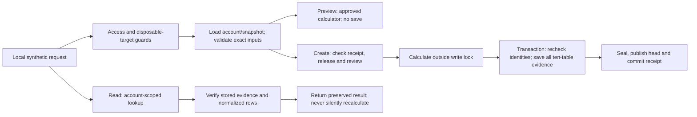

# B3 implementation-readiness review

**Later approval: B3B-R READ-ONLY only.** The owner authorized the four account-scoped GET routes and new synthetic fixture provisioning. See the [B3B-R report](phase-2b-4b-b3b-r.md). This does not authorize the full B3B stage, any accepted creation/lifecycle API, B3C, runtime installation, normal-journal migration, deployment or push. Earlier proposal/approval wording below is retained as historical context; only the explicitly approved subsets have been implemented.

**Approval update: B3A only, Option A, was explicitly authorized after this review.** Its implementation and measured results are recorded in the [B3A guide](phase-2b-4b-b3a.md). B3B and B3C remain unauthorized. The proposals below describe the broader future API and do not grant permission to implement later stages. B2's validated SQLite scope is accepted and closed at `8ce38bbc4b322fa7babf2014c90cc95aa2a157dd`. PostgreSQL execution and historical container replay remain **UNVERIFIED**. No runtime installation, normal-journal migration, deployment or push is authorized.

## 1. What exists and what is missing

The [B1 design](phase-2b-4b-design-review.md), [B1 addendum](phase-2b-4b-b1-addendum.md) and [B2 guide](phase-2b-4b-b2.md) remain the governing architecture. Their earlier approval-status paragraphs are historical; the later owner acceptance closes B1/B2's approved SQLite work. This document narrows the first API delivery to preview, create and read. It does not authorize the later correction/lifecycle endpoints in B1.

Reviewed source:

| Existing component                                                         | B3 implication                                                                                                                                       |
| -------------------------------------------------------------------------- | ---------------------------------------------------------------------------------------------------------------------------------------------------- |
| `app/analytics/cfd_positions.py`                                           | Reuse the separate one-entry/multiple-exit CFD engine and its 160-digit Decimal context. Do not alter crypto calculations.                           |
| `app/schemas/cfd.py`, `cfd_positions.py`, `cfd_results.py`, `financial.py` | Reuse financial validation, availability reasons, rounding and dated FX rules; add a stricter HTTP boundary around them.                             |
| `app/services/multi_asset.py`                                              | Reuse trusted identity loading and the existing snapshot hash algorithm; never accept an embedded browser specification as authoritative.            |
| `app/database/cfd_schema_v1.py`, `cfd_guards_v1.py`                        | Ten-table storage, immutable history and SQL guards exist. Python must still enforce aggregate financial meaning and canonical-document equality.    |
| `tests/cfd_ledger_helpers.py`                                              | Synthetic SQL fixture driver only. Its host/test-only manifest and canonicalizer must not become accepted production save logic.                     |
| `app/core/management_access.py`, `scripts/accounts_practice.py`            | Existing Accounts practice remains at 0003. Its path checks do not admit the proposed new CFD directory; do not weaken them or upgrade that session. |
| `app/main.py`, Next management bridge                                      | Neither exposes CFD persistence. New CFD access must not be silently mounted on the normal application or pointed at its API URL.                    |

B2 reported 557 passing backend tests and 14 browser tests. Those are prior executed results, not new tests performed for the original review. The B3A guide now records tests of the unavailable-runtime HTTP boundary. Real release execution has not been demonstrated.

Think of B2 as a protected filing cabinet. B3 adds a service desk: it checks the account and rule card, calculates with an approved recipe, files every page together, then returns a receipt.

## 2. Runtime decision: an explicit blocker

B1 requires an approved, versioned, offline OCI calculation release for accepted saves and computational replay. No such operational runtime is approved or installed. The current host calculator and B2 test manifests do not satisfy that requirement.

| Option                                            | Proposed behavior                                                                                                                                                                                                                                                        | Approval needed                                                                                                          |
| ------------------------------------------------- | ------------------------------------------------------------------------------------------------------------------------------------------------------------------------------------------------------------------------------------------------------------------------ | ------------------------------------------------------------------------------------------------------------------------ |
| **A. Strict policy, recommended default**         | Build contracts, isolation, preview routing and verified reads; build create logic behind an unavailable-runtime gate. Preview/new accepted creation return 503 when the approved runtime is unavailable. Test doubles exercise orchestration only.                      | Explicit approval of the individual B3 stage. No runtime-policy exception.                                               |
| **B. Additional host-preview-only practice mode** | An explicitly selected new practice runner may call the existing host calculator for nonpersistent synthetic previews. Response declares `execution_kind: host_preview`, `approved_release: false`, `saved: false`, `can_create: false`. No CFD ledger rows or receipts. | Separate explicit approval of this preview-only execution option before coding/enabling it. Not assumed by B3A approval. |
| **C. Host-backed practice saves**                 | Not part of this recommendation. A label or feature flag cannot turn a B2 fixture manifest into an approved accepted release.                                                                                                                                            | A separate B1 runtime/provenance policy amendment and segregation/promotion review. No such exception is authorized.     |

**Yes, B3 can be developed with accepted creation disabled.** That produces tested application logic and a clearly blocked feature, not an operationally validated accepted-save service. Fake-runtime test success must never be reported as container execution or historical reproducibility.

Default preview also fails closed under option A; it does not silently fall back to the host. Option B is useful for learning while runtime approval is pending, but is an additional decision. A host preview's hashes are not an accepted save token. Creation must independently execute the allowlisted release and require a review of its actual result.

### Required release contract before enabling real accepted creation

- The release registry pins an immutable platform-specific OCI digest, approved signing key and signed manifest. Tags, user-supplied image URLs, arbitrary Python paths and uploaded executables are never executable inputs.
- The signed payload identifies calculator/contract/canonicalizer/policy versions, source and dependency hashes, Python patch, platform/architecture, Decimal context and rounding rules. The signature covers canonical payload bytes, excluding its own signature; `manifest_sha256` covers the complete canonical stored envelope, including signature metadata. Keep historical trust/approval records.
- `engine_build_sha256` is the 64-hex image digest component; the manifest retains the full `sha256:...` reference. Confirm this mapping in contract tests before any accepted save. `engine_id` remains `cfd-position-v1`; neither a label nor the Git commit alone identifies the release.
- Run offline, without broker credentials, with a read-only runtime and private disposable input/output. Propose one calculation worker, 1 CPU, 256 MiB and a 10-second execution budget, subject to maximum-ledger measurement and separate runtime review. Limit output while reading, not after buffering an unlimited result. A local runtime invocation is still bounded work; never hold SQLite's write lock while waiting for it.
- New releases receive golden-fixture comparisons and reviewed financial differences. Historical records retain their original release; no upgrade rewrites their inputs, results, currencies or risk. Missing or revoked execution capability disables execution, not access to intact preserved evidence.
- Before installation or making this dependency operationally mandatory, separately document exact supported Windows/WSL versions, virtualization, hardware and disk/memory requirements, setup/removal commands and journal isolation. No installation, daemon start or container probe is part of this planning task.

## 3. A completely separate 0004 practice workspace

Proposed new runner: `services/api/scripts/cfd_practice.py`. This file does not exist yet. It creates a fresh `ava-cfd-practice-<random>` directory under OS Temp, with `cfd-practice.db`, private diagnostic/output directories and a process-owned registration of the exact permitted database path. It accepts no database-path, resume, import, backup or normal-journal argument.

The explicit runner command would:

1. Ignore/overwrite inherited database/upload settings before importing database/application modules. Validate the new resolved target before engine creation; reject symlink/junction escapes and verify the actual bound target again before every operation.
2. Explicitly provision **only that new target** through 0004, outside API startup. The app itself never runs migrations. Verify revision, integrity and foreign keys before serving. On failure, stop and retain sanitized disposable diagnostics instead of deleting evidence automatically.
3. Seed documented synthetic accounts and USDJPY/XAUUSD/XAGUSD rule cards using existing validation services. Print synthetic account/snapshot references for testing. Do not copy Accounts practice records, real broker specifications, the normal database or either backup. Seed services run only during fresh provisioning; expose no general fixture-loading endpoint.
4. Bind a separate CFD-only FastAPI app to `127.0.0.1:8003`. It exposes no crypto journal or account-mutation routes. Default accepted-create enablement remains false regardless of whether Docker happens to be present.
5. Announce that successful practice-session data is temporary. Remove only the runner-owned directory on a normal agreed shutdown; retain failed rehearsal diagnostics. Never clean up an inferred path or existing practice directory.

Keep normal 3000/8000, Accounts practice 3200/8002 and browser regression 3100/8001 unchanged. If B3C's browser bridge is approved, use a separate frontend test process on 3300 with `.next-cfd-practice` and a dedicated server-only `CFD_API_BASE_URL` for 8003. Missing/invalid CFD configuration must fail, never fall back to the normal journal URL. No CFD journal forms are included in B3.

Proposed `CfdPracticeSettings` are separate from Accounts enablement: practice access disabled by default; new accepted creation disabled by default; host preview disabled by default; runtime registry unavailable by default. A flag alone cannot authorize an ordinary path or an unapproved runtime. API guards require exact process-owned path registration, absolute SQLite target, correct file/directory, revision 0004 and FK enforcement. Migration's broader temporary-path allowlist is not sufficient API authorization. A copied database in an arbitrary matching Temp folder must fail the API guard. No PostgreSQL target is admitted.

Read-only sample catalog requests for this runner can be supplied through its startup reference manifest in B3A; do not repoint or widen the existing management endpoints. If interactive account/catalog APIs later prove necessary, propose them separately rather than quietly expanding B3.

## 4. HTTP contract

Proposed prefix: `/api/v1/cfd`, mounted only in the new practice app. Route names and versions below are design decisions for approval, not existing endpoints.

| Endpoint                                                              | Request                                               | Success / side effects                                                                                                                                       |
| --------------------------------------------------------------------- | ----------------------------------------------------- | ------------------------------------------------------------------------------------------------------------------------------------------------------------ |
| `GET /status`                                                         | Local access guards; no account query                 | 200: practice/read/preview/new-create capabilities, release identifiers or blocked reasons. Never filesystem paths, credentials or private account contents. |
| `POST /preview`                                                       | `CfdPreviewCommandV1`                                 | 200 calculated or explicitly unavailable outcome; no ledger/root/event/head/receipt writes. Runtime-policy block is 503.                                     |
| `POST /positions`                                                     | `CfdCreateCommandV1` + `Idempotency-Key`              | 201 with the committed revision-1 receipt; no partial save. Missing approved runtime blocks new creation.                                                    |
| `GET /positions?account_id=...&limit=50&cursor=...`                   | Required account scope; limit 1–100; validated cursor | 200: current published records, keyset pagination by `(created_at,id)`. No account-wide currency sums.                                                       |
| `GET /positions/{position_id}?account_id=...`                         | UUID position; required account scope                 | 200 verified preserved current record, explicit integrity/provenance/replay status and ETag.                                                                 |
| `GET /positions/{position_id}/revisions?account_id=...`               | Account scope; paginated history                      | 200 revision metadata; no historical/current mixing.                                                                                                         |
| `GET /positions/{position_id}/revisions/{revision_no}?account_id=...` | Account scope; positive integer revision              | 200 preserved selected revision, explicitly historical when not current.                                                                                     |

No update, archive, restore, void, replace, DELETE, broker, upload, migration or replay-execution endpoint in this first delivery. Unsupported methods are 405; unlisted paths are 404. Original-risk correction/lifecycle APIs need their own later review. A future mutation must use If-Match and the B1 CAS/receipt protocol; reserving that design does not implement it now.

### Exact request shape

`CfdPreviewCommandV1` is a strict object with these fields. Unknown fields are rejected, including embedded `account`, `snapshot.specification`, calculated results, manifests, paths and runtime commands.

| Field                | Contract                                                                                                                                                                                                                                                              |
| -------------------- | --------------------------------------------------------------------------------------------------------------------------------------------------------------------------------------------------------------------------------------------------------------------- |
| `schema_version`     | Literal `cfd-api-command-v1`; the server explicitly builds engine request `cfd-position-v1`.                                                                                                                                                                          |
| `account_id`         | Existing `Identifier`, nonblank, at most 100 characters; trusted account loaded by server.                                                                                                                                                                            |
| `snapshot_id`        | UUID referencing an existing immutable snapshot in this workspace.                                                                                                                                                                                                    |
| `position_reference` | Caller-generated UUID draft, retained across preview and retries. Server generates revision/receipt IDs.                                                                                                                                                              |
| `trade`              | Only `direction`, `entry`, `exits`, `original_stop`, `planned_take_profit`, `adjustments`, `reporting_policy`, `conversions`, `risk_conversion_id` from the approved CFD contract. Defaults match that contract; account/snapshot/schema fields are server assembled. |
| `rounding`           | Complete `CfdRoundingPolicy`, including every cost, native and reporting currency. No default currency precision inferred.                                                                                                                                            |
| `as_of`              | Explicit financial cutoff, not the current server clock.                                                                                                                                                                                                              |
| `recognition_policy` | Literal `incurred_once`.                                                                                                                                                                                                                                              |
| `broker_evidence`    | Existing bounded `BrokerReportedValue` list, default empty; preserve reported values separately.                                                                                                                                                                      |
| `release_digest`     | Optional for preview: absent selects the configured approved candidate, or yields runtime unavailable. A supplied digest must be supported/approved; no tag/URL resolution from the request.                                                                          |

Executions retain ID, timezone-aware execution time, price and lots strings, plus optional profit FX reference. Adjustments retain ID, kind, signed amount string, currency, occurrence time, source/reference, description, optional execution and conversion references. FX retains ID, source/target currencies, rate string, observed/application times, maximum age and source/reference. Sources describe supplied evidence; they do not certify broker authenticity.

`CfdCreateCommandV1` uses the same fields plus required `review`: `account_sha256`, `snapshot_sha256`, `input_sha256`, `result_sha256`, `original_risk_sha256`, `release_digest`, `canonicalizer_version`, `policy_version`. All hashes are lowercase 64-hex strings except the prefixed OCI digest. The reviewed release must equal the command's explicit `release_digest`. These bind the submitted command to the reviewed server calculation; they are not authority, signatures or proof that a human examined it. Create independently loads, calculates and compares everything. Host-preview results cannot satisfy accepted-release readiness.

HTTP financial fields must be strings; reject floats, booleans and JSON numeric money/lots/prices. Integer counts such as rounding places and FX age remain strict integers. Preserve the existing pure-engine contracts, which also accept exact Python Decimal/integer values internally; do not modify them to enforce a transport rule. Validate input precision/ranges under existing contracts: at most 38 digits/18 fractional places, finite values, field-specific positivity and bounds. No truncation.

### Response and errors

Preview envelope: `schema_version: cfd-preview-response-v1`, `saved: false`, `position_reference`, `result` (`CfdPositionResult` or `PositionUnavailable`), `execution` (kind/release/approval), `review` (only when a fully calculated candidate exists), `can_create`, `blocked_reasons`. `status: calculated` means the engine produced a typed result, not that every optional metric is available or the trade is saved.

Create envelope: `schema_version: cfd-position-response-v1`, `saved: true`, account/position/revision IDs, revision number 1, frozen engine input/result, immutable original-risk basis and accepted release/provenance **at creation**. `Location` points to the saved revision URL; ETag is quoted `"cfd-v1:<position-uuid>:<revision-no>:<result-sha256>"`. Store the canonical success status/body in the receipt. A matching retry returns that original 201/body plus `Idempotency-Replayed: true`; it never claims to return a newer head or a freshly replayed calculation. Live runtime availability belongs to status/read metadata, not the immutable receipt.

Read envelope additionally separates `integrity` (stored documents, normalized rows and manifest), `provenance` (approved release / synthetic fixture / unverified) and `replay` (`status: not_run`, plus available/unavailable/blocked execution capability). Never describe a hash comparison as computational replay. All financial values remain JSON strings or null with an explicit reason. Responses, including errors, use `Cache-Control: no-store`.

Error envelope: `error: {code, message, request_id, issues:[{path,code,message}]}`. At most 20 sanitized issues; omit input values, private paths, SQL, stack traces, broker references and secrets. Do not pass Pydantic's raw `input` or arbitrary exception strings through to logs/responses.

| Status    | Code / example                                                                                                              | Write outcome                                                                                               |
| --------- | --------------------------------------------------------------------------------------------------------------------------- | ----------------------------------------------------------------------------------------------------------- |
| 400       | `invalid_idempotency_key`: “Supply one valid Idempotency-Key.”; malformed/duplicate-key JSON or invalid cursor              | No writes                                                                                                   |
| 403       | `practice_access_denied`: “CFD access requires the isolated local practice session.”                                        | Reject before DB connection where possible                                                                  |
| 404       | `resource_not_found`: “CFD record or compatible resource not found in this account.”; disabled/unmounted feature            | No cross-account existence disclosure                                                                       |
| 405 / 415 | Unsupported method / JSON content type or content encoding                                                                  | No writes                                                                                                   |
| 409       | `idempotency_conflict`, `position_reference_conflict`, `event_identity_conflict`, `review_changed`, `integrity_failure`     | No new committed graph; integrity failure withholds suspect financial results                               |
| 412 / 428 | Reserved for stale/missing If-Match on future edit APIs                                                                     | No edit API in B3A–C                                                                                        |
| 413       | `payload_too_large` / `evidence_too_large`                                                                                  | Reject; never truncate evidence                                                                             |
| 422       | Field validation, incompatible scope, missing explicit FX/precision, unsupported mode/release                               | No writes; clear field-level guidance                                                                       |
| 429       | `rate_limited` with Retry-After                                                                                             | No calculation/save admitted                                                                                |
| 503       | `creation_disabled`, `calculation_runtime_unavailable`, bounded `database_busy`, runtime timeout, or `save_outcome_unknown` | No new accepted save when blocked; uncertain commit outcome must not be described as definitely rolled back |

Preview returns 200 with explicit engine `unavailable` for a supported, well-formed evaluation that cannot produce a result (for example numeric failure); malformed finance/missing evidence is 422. Create accepts only a fully calculated envelope, while permitting individually unavailable risk/reporting metrics when the reviewed policy legitimately makes them unavailable. No accepted root for an unsupported engine mode. Corrupt saved data is 409, not a fabricated fallback.

## 5. Preview and create process

### Preview: inspect without filing

1. Enforce access, target, body and rate limits; open only the registered practice database. Load the account and immutable snapshot/instrument through trusted services. Verify the existing snapshot fingerprint, broker, platform, server/venue, product, category/mode and settlement compatibility. Profit currency and reporting currency need not match.
2. Construct the full approved `CfdPositionRequest` using server-loaded identities. Normalize/validate exact amounts, timestamps and keyed evidence; reject over-closing including future exits. Preserve the explicit cutoff.
3. Select the permitted execution provider. Strict mode requires the approved release; otherwise 503. Optional separately approved host mode is visibly nonpersistent and unapproved for saving. Do not change provider implicitly after failure.
4. Calculate, validate output shape/currencies/bounds, derive original-risk basis, and return the candidate plus fingerprints and readiness. Never create a root, registry row, receipt, snapshot or account. Logs contain request ID, code and timing, not trade bodies.

### Create: one accepted envelope or none

1. Apply all access/target/request guards. Normalize the **client command** under its explicit version and compute the idempotency request hash, including account, operation `create`, draft ID, expected version `0`, review/release pin and exact normalized financial fields. Exclude audit times, server-generated IDs and the key itself. Do not derive this hash from mutable current account names or today's default release.
2. In the required account scope, inspect the committed receipt **before** a draft-collision check, current review check or new-runtime gate. Same key/hash: verify its reference graph and immutable response, return the original receipt without execution. Different hash/operation/resource: 409. A previously accepted receipt may be replayed when new creation is disabled; it makes no claim about current runtime availability.
3. For a genuinely new save, require creation enablement and the allowlisted release. Load trusted identities in a short read transaction; validate compatibility and review fingerprints. Construct canonical engine input and freeze the original-risk basis. Calculate outside the write lock using the pinned release. Validate the complete result/review hashes and evidence size. A stale preview requires fresh review, not silent acceptance of changed numbers.
4. Start explicit SQLite `BEGIN IMMEDIATE`, with a proposed 5-second bounded busy wait. Recheck receipt, draft/event-key collisions, actual account/instrument/snapshot state and fingerprints under the write transaction. If identity changed since calculation, roll back and require review. Do not rerun the runtime while holding the lock or call any broker/network service.
5. Insert in dependency order: root; unsealed revision 1; account-scoped stable event keys; conversion rows; entry/exits with ordinals; adjustments; broker evidence. Generate new revision/receipt UUIDs. Never populate legacy `trade_contexts` or modify 0003 parent identities.
6. Rebuild canonical input from the staged normalized rows and frozen account/snapshot/risk basis. Require exact equality with the validated input fingerprint. Store canonical input/result and hashes, original risk/snapshot anchors, signed release manifest and versions in `cfd_calculations`. Verify broker comparison values remain a separate observation.
7. Seal only after aggregate validation. Insert current head at version 1 and the successful immutable receipt. Verify all scope/anchor/shape relationships, then commit once. Publish no unsealed or unheaded construction. Build the success body before commit so serialization failures also roll back.
8. Return only after commit succeeds. A known failure rolls back the entire graph. A unique/receipt race first rolls back, then rereads receipt on a fresh connection: same command replays; key conflict is 409. After a lost/uncertain commit response, consult the receipt before deciding; if certainty is unavailable, return 503 with “Retry this same key and draft ID.” Never instruct a blind new-key retry or claim a failed response proves no save happened.

This preserves B1's atomic publication while keeping slow runtime work outside the lock. Python-level validation is essential: SQL triggers cannot prove every Decimal sum, risk JSON, request/result correspondence or valid release signature.

## 6. Canonicalization, risk and saved reads

Proposed version `cfd-ledger-json-v1` must be reviewed and golden-tested before any accepted evidence uses it. It is not B2's synthetic canonicalizer. Use plain finite base-10 Decimal strings, normalized without float conversion or context rounding; one spelling of zero. Normalize known timestamps to UTC with exactly six fractional digits and `Z`; reject naive/numeric timestamps and excess fractional precision **before** datetime parsing could truncate it. Reject duplicate JSON object keys.

Sort JSON keys, use deterministic separators and `ensure_ascii=True` encoded as UTF-8; document this exact spelling. Keyed evidence sets are sorted by adjustment/conversion/evidence ID; rounding currencies by currency. Keep validated exit order and persist ordinals, including distinct equal-time fills. Do not reorder fills to repair invalid chronology. Persist enough information to reconstruct the exact normalized engine request and result. Existing snapshot canonicalization/hashes remain unchanged, even when an equivalent decimal spelling differs. In particular, retain the frozen specification's v1 serialization inside engine input: do not normalize its Decimal strings under the new command rules and then pair it with its old snapshot hash. Normalize editable trade inputs and new result evidence under the new recorded version; preserve the immutable snapshot subtree under its original version.

Freeze `original_risk_basis` as versioned JSON: original direction/entry/lots/stop, account and snapshot hashes, reporting and rounding policy, complete entry-time risk FX evidence/reference, and both native/reporting original-risk values **or their unavailable reasons**. Store its hash on root/calculations. Original lots are never replaced by remaining lots; the risk denominator is not revalued using exit-time FX. A missing stop stays unavailable, not zero. An ordinary future amendment cannot change this anchor or turn its original unavailable reporting risk into a newly invented denominator.

Retain `incurred_once`: entry commission is recognized once in full at occurrence, even while open; exit commissions and swaps/credits use their own IDs/currencies/times. No proportional entry-cost allocation is introduced. One effective revision is calculated; do not sum costs/PnL across historical copies. Remaining lots never go negative; partial R is cumulative recognized net divided by fixed whole-position original risk. Open/partial records are not completed wins/losses. No valuation input means unrealized PnL stays unavailable. Actual execution spreads are not deducted again; leverage does not multiply profit.

### Read: retrieve a filed page, not rerun today's recipe

1. Verify access and account scope before any record details. Query by account and position together. Check head, selected revision, seal, calculation and scoped child/event relationships. No fallback to an unheaded/unsealed revision.
2. Under a consistent read transaction, verify the stored account contract and original-risk hashes, exact snapshot hash/scope, canonical input/result/manifest bytes and hashes, release provenance, normalized rows and frozen-anchor equality. Validate typed saved results using their recorded schema, not a rewritten current model. Never replace historical account facts with current display/settings values.
3. For known schema/canonicalizer versions, independently rebuild input from rows and compare to the saved canonical input. Read must not simply trust that an internally consistent JSON blob matches the normalized ledger. Receipt replay additionally validates receipt scope, request hash and saved response against the referenced revision.
4. Return preserved accepted result and independent integrity statuses. Do not call `calculate_position`, launch a container, change `as_of`, refresh FX or update any ledger/receipt on GET. An available runtime is not a replay that has occurred.
5. A known historical approved release with a missing execution runtime may still be displayed: `replay.status: not_run`, `replay.availability: runtime_unavailable`. If an old verifier/schema is missing, verified stored-byte hashes may support **preserved-only, unverified reconstruction** viewing; make that explicit and omit it from any verified summary/aggregation. Never interpret an unknown old schema as the newest schema. Actual mismatch/corruption is 409 and withholds suspect financial values.

Retain versioned serializers/verifiers and historical public trust keys along with the archived release. An intact hash is not proof against an administrator who can replace both content and hashes; signatures identify the approved release, not broker truth or an independently signed trade statement.

B2 fixture manifests remain `synthetic_fixture`, never `approved_release`. Fresh synthetic read fixtures may test the verifier through test-only provisioning, clearly labelled as such; there is no public fixture-import endpoint or accepted-save bypass. No new schema migration is currently proposed: existing TEXT evidence fields can hold these versioned envelopes. If implementation finds that B1 semantics cannot be represented, stop for schema review rather than silently changing 0004.

## 7. API boundaries and limits

- Bind only loopback; validate real client address and exact allowed Host/port, reject forwarded-host spoofing and disable trust in proxy headers for the direct runner. Require distinct local header `X-AVA-Local: cfd-practice-v1`. It is a local request boundary, **not authentication** or a broker credential.
- In B3A/B3B, reject browser Origin requests unless the exact approved test origin is configured; missing Origin is permitted only for already-local direct API tests. No wildcard CORS or credential forwarding. A future B3C bridge checks same-origin, exact route/method allowlists, bounded bodies, no redirects and no-store. It must not forward arbitrary upstream/host/auth headers or accept a user-selected URL. Validate bound DB again independently of these network checks.
- Account isolation is request scope inside one synthetic local workspace, not multiuser ownership. A caller allowed to use this workspace may select its synthetic accounts; account IDs are not passwords. Test wrong-account lookups and child joins. Real private/multiuser data and public access require a separately reviewed authenticated principal/ownership model before enablement.
- Require one `Idempotency-Key` on create: 1–100 ASCII letters/digits/underscore/hyphen; recommend a random UUID. Do not truncate or silently replace it. Keys are account-scoped across operations, retained with history and never auto-expired. Reject duplicate header occurrences and ambiguous bodies. A new key/new draft can still disguise an economic duplicate; no broker-import deduplication claim.
- Retain proposed B1 limits: **4 MiB UTF-8 command**, **32 MiB combined canonical input/result evidence**, existing maximum 1000 exits, 1000 adjustments, 2001 conversions, 100 broker observations and 1002 currency rounding entries. Enforce byte limits while streaming even without Content-Length, and after canonicalization before saving. Reject compressed request bodies initially; cap JSON nesting at 16 and validate string limits before expensive work. Benchmark maximum valid ledgers before treating budgets as proven capacity; B1 storage forecasts remain estimates.
- Proposed per-process local limits: 30 previews/minute, 10 new-create attempts/minute, 120 reads/minute; one calculation at a time with at most two waiting requests. Excess returns 429/Retry-After. Keep retry/receipt lookup bounded too. Measure these limits in synthetic tests; they are proposed settings, not current guarantees.
- Proposed time budgets: 10 seconds calculation, 5 seconds SQLite contention and 30 seconds end-to-end; bridge deadline slightly above API deadline. Cancellation/timeouts must terminate local calculation work and clean only owned scratch files. A client timeout after commit is resolved by the receipt, not another save. Make feature/readiness messages distinct from database/integrity failures.
- Keyset cursors bind account, filters and last tuple, are size-limited and validated before SQL; no raw SQL/sort expressions. List only current published roots by default; historical records are explicitly requested. No raw account broker reference, local path or unbounded result JSON in summary lists. Detailed data stays under the verified, scoped record route.

## 8. USDJPY learning example

These are synthetic inputs, **not Bybit specifications or market observations**. A new runner seeds a USD-reporting/USD-settlement CFD account, broker/server/venue `SYNTHETIC-B3`, and a matching USDJPY snapshot: forex mode, contract 100000 per lot, profit JPY, tick 0.001, pip 0.01, lot step/min 0.01. Its documented effective time precedes entry. Use runner-issued account/snapshot IDs and one retained draft UUID.

| Input/event                     | Supplied value                              | Meaning                                                                      |
| ------------------------------- | ------------------------------------------- | ---------------------------------------------------------------------------- |
| Buy entry, 2026-10-01 09:00 UTC | 0.10 lots at 150.000; original stop 149.800 | 10000 base units; original planned risk `(150−149.8)×0.10×100000 = 2000 JPY` |
| First exit, 10:00 UTC           | 0.04 lots at 150.200                        | `0.2×0.04×100000 = 800 JPY`; 0.06 lots remain                                |
| Second exit, 11:00 UTC          | 0.06 lots at 150.300                        | `0.3×0.06×100000 = 1800 JPY`; cumulative 2600 JPY, no remaining lots         |
| Entry-time risk FX              | 0.006 USD per JPY                           | Original USD risk `2000×0.006 = 12 USD`                                      |
| First/second exit FX            | 0.0065 / 0.0068 USD per JPY                 | Realized USD profit `800×0.0065 + 1800×0.0068 = 17.44 USD`                   |

Supply each FX record with its unique ID, JPY→USD direction, observed/application times equal to the referenced event, maximum age 0 and source `manual / Synthetic teaching rate`. Entry uses `risk_conversion_id`; each exit its own `profit_conversion_id`. All prices/lots/rates are strings. Supply JPY 0 places, USD 2 places, half-even rounding and explicit ratio/movement places. `as_of` is 11:00 UTC; no costs, broker evidence empty, recognition `incurred_once`, reporting `explicit_rates`.

**Preview:** submit those facts and stored identity references to `/preview`. Strict mode currently would return runtime unavailable; after approved runtime enablement, expect native net **2600 JPY / 1.30R**, reporting net **17.44 USD / 1.453333R** at six ratio places. Different R values are intentional because risk and profits used different dated rates. A separately authorized host preview can teach the numbers but remains unsaved/unapproved.

**Save:** reuse the draft ID, submit the returned review fingerprints and release pin plus `Idempotency-Key`. An enabled accepted-save service repeats validation/calculation, commits one position/revision/head/receipt and returns 201. Until runtime approval/readiness, expect 503 and zero new rows. Repeating the same committed command/key returns the original receipt; changing an exit while reusing that key returns 409.

**Read:** GET the returned position URL with its account ID. Expect the same native/reporting amounts, specification reference, fixed risk and historical cutoff. GET never fetches today's rate or calls today's calculator. If the old runtime later disappears, preserve intact saved results while showing runtime unavailable.

At the first-exit cutoff, native gross is 800 JPY and cumulative original-risk R is 0.40R, not `800 / risk for 0.04 lots`; reporting gross is 5.20 USD against the fixed original 12 USD risk. Later supplied exits remain deferred but still count toward over-close validation.

If reporting FX is omitted by deliberately selecting `native_only`, no-cost native net/R can still be 2600 JPY/1.30R while USD results are unavailable. A JPY commission can reduce native net/R. A USD commission cannot be silently added to JPY: even with complete reporting FX, this engine does not convert USD costs back into a different native currency. Native gross/risk remain known; native net/R may be unavailable. Preserve that approved limitation. Unrealized profit and broker liquidation/margin requirements are not inferred.

## 9. Planned tests — not executed in this review

Every test provisions a new owned disposable database or synthetic in-memory unit fixture. No test may connect to the normal journal or existing practice data even to check rejection. Retain existing 557 backend/14 browser regressions; future totals are measured, not promised.

| Area                     | Required automated evidence                                                                                                                                                                                                                                                                                                                                                                                                 |
| ------------------------ | --------------------------------------------------------------------------------------------------------------------------------------------------------------------------------------------------------------------------------------------------------------------------------------------------------------------------------------------------------------------------------------------------------------------------- |
| Default/runtime gates    | Normal app exposes no CFD route; new app disabled by default; absent release, bad signature, wrong digest/schema/policy, timeout and host-provider injection produce correct errors and zero accepted writes. Test doubles never enable a real runner.                                                                                                                                                                      |
| Target/access            | Reject normal/relative/backup paths before connection, copied matching-prefix databases, symlink/junction escapes, wrong actual bind, wrong revision, existing Accounts prefix, PostgreSQL DSN, external Host/Origin/client, spoofed forwarded headers and missing local header. Use path strings/fake binds for protected targets.                                                                                         |
| Preview                  | Exact no-cost/costed EURUSD 26/1.30R and 22/1.10R; USDJPY above; declared gold/silver; shorts/losses/breakeven; unsupported modes; unavailable native/reporting fields; inventory of all ten tables unchanged. No account/snapshot creation.                                                                                                                                                                                |
| Financial validation     | Decimal string precision/ranges, no floats/bools/numeric dates, tick/lot grids, stop direction, missing stop, rounding currencies, equal-time exits and ordinals, future/deferred over-close, FX direction/time/age, USD≠USDT, duplicate/unreferenced evidence and no double-counted costs.                                                                                                                                 |
| Create                   | Trusted identity rather than caller objects; broker/currency match but server/venue mismatch; snapshot/account review changed after preview; one complete sealed version-1 graph; source/time/risk and separate broker values preserved; unsupported result or oversized evidence saves nothing.                                                                                                                            |
| Transactions             | Fail after each insertion group, calculation, seal, head, receipt, serialization and commit boundary. Verify exact pre-attempt inventory, successful-receipt absence on known rollback, unchanged synthetic legacy IDs/screenshots/calculations, safe same-key retry. Simulate uncertain commit separately.                                                                                                                 |
| Retries/conflicts        | Sequential and simultaneous same key/same normalized command give one graph and original 201/body; reordered keyed evidence and equivalent decimal spellings replay. Different payload/operation/resource is 409; same key in different accounts is independent. Draft/event collisions under a new key are 409. Lost reply after commit replays even after another test-fixture revision exists or runtime is unavailable. |
| Races                    | Real independent SQLite connections with barriers: duplicate creates, different-key same-draft creates, root creation versus parent identity change, lock timeout and receipt race after rollback. No mixed account/spec pair or duplicate head. Future edit schedules/412/428 remain tests for later edit API authorization, not a B3 create/read claim.                                                                   |
| Read/integrity           | Account-scoped current/historical retrieval and pagination; no foreign-account existence leak; no unheaded/unsealed publication. Spy proves GET never executes an engine or writes. Reconstruct all normalized rows; compare hashes and frozen anchors.                                                                                                                                                                     |
| Tampering                | In disposable adversarial fixtures, alter snapshot/root/risk/child/result/input/manifest/receipt content and/or rehash a document while leaving rows inconsistent. Verification must detect the applicable mismatch. Database-owner rewrites of every artifact are outside hash-only security; do not claim otherwise.                                                                                                      |
| Historical compatibility | Pin golden canonical decimal/UTC/keyed-set/exit-order encodings; old/new schemas and canonicalizer versions; display preserved-only when verifier absent; approved historical release missing runtime; no upgrade rewrites. B2 host/test manifests never become accepted-release evidence.                                                                                                                                  |
| Transport                | Body streaming without Content-Length, compressed/duplicate-key/deep JSON, oversized evidence, limits/429, sanitized 20-issue errors, no-store, bounded timeouts, retry headers and bridge allowlist/header forwarding. No paths/credentials/trade bodies in logs.                                                                                                                                                          |
| Regression               | Full backend, Ruff, frontend lint/types/format/build and desktop/mobile existing journal/Accounts flows in their own fresh browser environment. No crypto formula or legacy migration change.                                                                                                                                                                                                                               |
| Real release gate        | Separately approved runtime required to run actual signed-image preview/create/read, offline isolation, resource bounds, golden reproduction and historical replay. Until then: UNVERIFIED, not “passed” by mocks. PostgreSQL remains a separate unverified gate.                                                                                                                                                           |

Manual plan, after the corresponding implementation is authorized:

1. Start only the new runner; verify new temporary path, 0004, synthetic IDs, port 8003, blocked creation and no use of an existing session. Verify the disabled-runtime response. This proves isolation/readiness, not calculation execution.
2. If host preview option B is separately approved, submit the USDJPY example and confirm unsaved/unapproved labels and zero ledger rows. Refresh/repeat: still no receipt or trade.
3. After actual runtime approval, preview the same example, review its native/reporting values and release, then save once. Inspect 201, revision URL and all ten-table invariants in the disposable target.
4. Retry same key/body; confirm identical receipt and one position. Change one exit with the same key; confirm 409 and unchanged saved result.
5. Read the record, refresh and select its historical revision. Confirm no clock/rate refresh, fixed risk and separate reported evidence. Try another synthetic account ID and confirm safe 404.
6. Exercise the missing-FX/precision/over-close/server-mismatch errors with no partial saves. Automated fixtures, not manual alteration of real files, handle corruption and injected rollback.
7. If the B3C bridge is approved, exercise its JSON requests, allowlist, response headers and errors. Recheck the existing journal/Accounts interfaces at desktop/390px with keyboard access, dark/light modes and the purple/green/red design. No new CFD screen or form is implied by a JSON bridge; those remain phase 2B.4C. Stop only this new practice process; record owner observations separately from automated results.

## 10. Proposed implementation stages and files

These are proposed paths, not files created by this review. Each stage requires its own explicit authorization and local milestone report/commit; no automatic push.

| Stage                                            | Build and affected files                                                                                                                                                                                                                                                                                                                                                                                                                                                  | Acceptance / remaining block                                                                                                                                                                                                                                                                     |
| ------------------------------------------------ | ------------------------------------------------------------------------------------------------------------------------------------------------------------------------------------------------------------------------------------------------------------------------------------------------------------------------------------------------------------------------------------------------------------------------------------------------------------------------- | ------------------------------------------------------------------------------------------------------------------------------------------------------------------------------------------------------------------------------------------------------------------------------------------------ |
| **B3A: isolated contracts and preview boundary** | New `app/cfd_practice.py`, `core/cfd_access.py`, `core/cfd_settings.py`, `database/cfd_session.py`, `schemas/cfd_api.py`, `services/cfd_canonical.py`, `services/cfd_runtime.py`, `api/cfd.py` (status/preview only), `scripts/cfd_practice.py`, new synthetic fixtures and `tests/test_cfd_preview_api.py`, `test_cfd_access.py`, canonicalization tests. Reuse existing contracts/0004; do not mount routes in normal `main.py` or reuse its global session dependency. | Fresh isolated 0004 runner, explicit versions/normalization, local/API limits and default runtime-unavailable response; zero ledger writes. Provider tests can exercise expected calculations without certifying container execution. Real host preview only if option B is separately approved. |
| **B3B: verified read and gated create**          | New `services/cfd_records.py`, `services/cfd_integrity.py`, tests for save/read/idempotency/races/rollback/historical evidence; extend `schemas/cfd_api.py` and `api/cfd.py` for the listed create/read routes. No model/0004 edits planned.                                                                                                                                                                                                                              | Normalized persisted input equals reviewed input; exact result/risk/provenance/receipt round-trip; all HTTP and transaction tests pass. New accepted creation remains disabled without approved operational runtime. Mock tests prove orchestration only.                                        |
| **B3C: integration and owner acceptance**        | Optional explicitly allowlisted Next route `apps/web/src/app/api/cfd/[[...path]]/route.ts`, typed `features/cfd/api.ts`/contracts and browser/API acceptance fixtures; document runner orchestration on 3300/8003 and `.next-cfd-practice`. No trade forms.                                                                                                                                                                                                               | End-to-end proxy/access/response tests, synthetic manual acceptance and regression report. Accepted-save/replay claims require separately approved actual runtime tests; otherwise label runtime-dependent scenarios BLOCKED. No normal migration or production enablement.                      |

Existing journal, crypto calculator, account management/practice runner, historical migrations and both backups remain unchanged. If a new migration is discovered to be necessary, stop for separate review. Lifecycle/edit APIs, general account management in this runner, real statements/import, combined analytics, broker sync, public authentication rollout and real data are outside these stages.

### Decisions for owner review

| Decision                         | Recommendation / unresolved condition                                                                                                                                                                                                    |
| -------------------------------- | ---------------------------------------------------------------------------------------------------------------------------------------------------------------------------------------------------------------------------------------- |
| Runtime behavior for first stage | Approve A: strict blocked runtime by default. Choose B separately only if a usable host-preview-only teaching API is desired now. No host saves.                                                                                         |
| Stage scope                      | Approve B3A only first; B3B and B3C remain later gates. No edits/lifecycle/replay-execution endpoint included in these three stages.                                                                                                     |
| API/normalization contract       | Review response/error codes, review fingerprints, release digest mapping, precision/timestamp/ordering rules and proposed limits before freezing v1. Preserve B1's accounting semantics.                                                 |
| Practice isolation               | Approve the new exact-target runner and proposed ports; seed synthetic identities rather than reusing existing practice accounts. No normal migrations.                                                                                  |
| Operational acceptance           | Real signed-release execution, Windows installation/resource review, key/manifest approval and golden runtime comparisons remain unsatisfied. Installing a runtime requires separate permission; it is not implied by API-code approval. |
| Verification/capacity            | Maximum-body/evidence timing/memory and storage estimates need synthetic measurement. PostgreSQL and historical container replay remain unverified until separately demonstrated.                                                        |

Release governance also remains unresolved: before operational acceptance, choose the signature algorithm/verification dependency, maintainer approval authority, pinned-key distribution and retirement policy, signed registry format, and retained verifier/artifact archive. B3A's unavailable provider does not settle or implement these decisions. No key generation, dependency installation or registry approval occurs in this review.

### Exact authorization needed to start B3A

Suggested approval wording:

> I authorize B3A only: the separate disposable-0004 CFD practice runner, strict API/normalization contracts, local/target guards, status and preview boundary, runtime-provider interface and automated tests. Use runtime option A: no host fallback; preview and new accepted creation remain unavailable without the approved release runtime. Test doubles are permitted only in automated tests and do not certify runtime execution. Do not implement create/read endpoints yet, migrate or access normal/existing practice data, install a runtime, alter accounting, deploy, connect brokers or push without separate approval.

Optional **additional** approval, not included above:

> I also authorize option B solely for explicitly selected, unsaved synthetic host previews in the new runner. They must be labelled unapproved for accepted saves; no ledger/receipt writes and no host-backed creation.

The owner subsequently authorized only B3A under Option A. No later-stage authorization is assumed from completion or publication of this plan. Documentation may be saved locally; a push needs separate owner approval.
