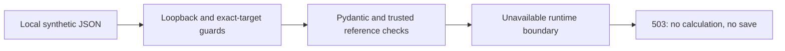

# B3A: isolated CFD API boundary, Option A

B3A implements a separate local service desk for synthetic CFD requests. It validates inputs but does not execute financial previews or save CFD positions. No approved container release is operational. B3B, B3C, runtime installation and a GitHub push still require separate approval.

## What works

- Explicitly launch a new disposable SQLite workspace at revision 0004, using the unchanged approved migrations. Seed two synthetic accounts and USDJPY, XAUUSD and XAGUSD specifications. These are teaching specifications, **not Bybit contract rules**.
- `GET /api/v1/cfd/status` reports unavailable runtime, no host fallback, no saving, no saved-position reads, and unverified PostgreSQL/replay.
- `POST /api/v1/cfd/preview` validates references and financial inputs. A compatible valid request returns **503 `calculation_runtime_unavailable`**. It never returns calculated PnL or a successful save.
- Decimal strings, explicit timestamps, partial-exit quantities, dated FX, costs, cutoff and rounding rules reuse existing financial contracts. Binding and normalization do not calculate or freeze risk.
- Load authoritative accounts and immutable, hash-checked snapshots from this new workspace. Reject incompatible broker/server/venue/product/settlement relationships. Submitted account/specification objects cannot override them.
- Serving connections enforce SQLite `query_only=ON`, foreign keys and revision 0004. Tests compare every table before and after requests, including legacy tables and account/specification rows.



There is no create/read/update/delete/void/replacement API, browser bridge, trade-entry form or broker integration. The reserved future success-response type is not emitted; its completion with B3B review fingerprints and release metadata must be reviewed before enabling successful previews. No accounting or accepted-runtime policy has changed.

## Isolation and limits

The normal app does not mount these routes. The separate app factory is disabled by default and never provisions a database at startup. The explicit runner creates a **new** OS-temporary `ava-cfd-practice-...` directory and `cfd-practice.db`, migrates only that owned target, seeds it, then serves on `127.0.0.1:8003`. It accepts no database/host/path arguments, cannot resume an old workspace and does not upgrade the existing Accounts practice session.

Target checks happen before connection: exact URL, process registration, absolute owned path, directory/file identity and no symlink/junction. A `do_connect` listener additionally checks the actual SQLite DBAPI argument before opening it. Rejected normal/backup/foreign targets are tested using strings and connection spies, not by opening protected files. A matching temporary-directory prefix alone is insufficient.

Normal shutdown removes only the verified newly created directory. Provisioning/context exceptions preserve the new synthetic diagnostic directory. This is not long-term storage; never enter real account or trading data. The runner overrides inherited database settings with an unused in-memory default before importing application modules; all actual CFD work uses its registered engine.

Requests require a real loopback client, exact Host `127.0.0.1:8003` or `localhost:8003`, and `X-AVA-Local: cfd-practice-v1`. All Origin and forwarded headers are rejected. There is no browser-origin allowlist or CORS access in B3A. This local header is **not authentication**, and provides no protection from hostile programs already running as your Windows user. Do not expose this app publicly or enable proxy forwarding.

| Boundary            | B3A behavior                                                                                                              |
| ------------------- | ------------------------------------------------------------------------------------------------------------------------- |
| Payload             | Up to 4 MiB, including streamed bodies without Content-Length                                                             |
| JSON                | UTF-8 JSON only; no compressed bodies, duplicate keys, nonfinite constants or nesting beyond 16 levels                    |
| Financial transport | Decimal strings up to 128 characters, then existing 38-digit/18-fractional-place limits; no numeric money, lots or prices |
| Time                | Explicit timezone ISO timestamps, at most six fractional digits; no numeric dates                                         |
| Collections         | 1000 exits, 1000 adjustments, 2001 FX observations, 100 broker-evidence items                                             |
| Rate                | Per process: 30 preview requests/minute, 120 status reads/minute; 429 and Retry-After                                     |
| Pending work        | One dispatched preview with at most two waiting; 30-second request budget                                                 |
| Database            | Five-second SQLite contention timeout; serving is read-only                                                               |
| Errors              | UUID request ID, at most 20 sanitized issues, no request values, arbitrary unknown field names, SQL or exception details  |
| Caching             | No-store and nosniff on responses                                                                                         |

Limits are enforced boundaries, not demonstrated maximum-throughput capacity. No container process exists, so termination/resource controls for an operational calculator remain unverified. Rate state is process-local and intentionally unsuitable for public multiworker service.

| HTTP      | Meaning                                                                                        |
| --------- | ---------------------------------------------------------------------------------------------- |
| 200       | Status only: capabilities remain disabled                                                      |
| 400       | Malformed, ambiguous or over-nested JSON/framing                                               |
| 403       | Local access or owned target rejected                                                          |
| 404       | Disabled app, missing resource or unsupported route                                            |
| 405       | Unsupported method                                                                             |
| 413 / 415 | Body too large / unsupported representation                                                    |
| 422       | Invalid financial fields or incompatible scope                                                 |
| 429       | Request budget exhausted                                                                       |
| 503       | Approved runtime unavailable; also separately coded database unavailability or request timeout |
| 500       | Unexpected internal failure, with a sanitized generic message                                  |

## Try it yourself

From the repository root, with the existing development dependencies installed:

```powershell
.\.venv\Scripts\python.exe services/api/scripts/cfd_practice.py
```

This is the only supported B3A runner. Do not launch the normal `app.main` to test CFD routes, pass a journal path or run Alembic manually. If port 8003 is occupied, stop and identify the conflict; do not kill an existing application blindly.

In a second PowerShell 7 terminal:

```powershell
$cfdHeaders = @{ 'X-AVA-Local' = 'cfd-practice-v1' }
Invoke-RestMethod -Uri 'http://127.0.0.1:8003/api/v1/cfd/status' -Headers $cfdHeaders
```

Expect `preview_available`, `can_create`, `can_read_saved_positions` and `host_fallback` to be false. PostgreSQL and historical replay remain `unverified`.

Copy the **new temporary directory printed by this runner** into this variable. It is used only to read the generated JSON example; it cannot select a database:

```powershell
$cfdPracticeDirectory = 'PASTE THE NEW DIRECTORY PRINTED BY THE RUNNER'
$cfdSample = Join-Path $cfdPracticeDirectory 'preview-usdjpy.json'
$cfdResponse = Invoke-WebRequest -Uri 'http://127.0.0.1:8003/api/v1/cfd/preview' -Method Post -Headers $cfdHeaders -ContentType 'application/json' -InFile $cfdSample -SkipHttpErrorCheck
$cfdResponse.StatusCode
$cfdResponse.Content
```

Expect **503**, with `error.code` equal to `calculation_runtime_unavailable` and the message “No calculation was run or saved.” This proves the blocked runtime boundary, not a financial result. Change a copy of the entry's lots string to JSON number `0.1` and expect 422 instead. Omit the local header and expect 403. Stop the runner with Ctrl+C when finished. These manual steps are provided for the owner; they are not user-reported acceptance results.

## Files in this milestone

All 13 Python files below are new. Existing crypto logic, models, frozen migration definitions, normal app and frontend source are unchanged.

| File                                         | Purpose                                                                         |
| -------------------------------------------- | ------------------------------------------------------------------------------- |
| `services/api/app/cfd_practice.py`           | Separate default-disabled app factory and safe exception handlers               |
| `services/api/app/api/cfd.py`                | Only status and blocked preview routes                                          |
| `services/api/app/core/cfd_settings.py`      | Explicit bounded settings; environment flags cannot enable it                   |
| `services/api/app/core/cfd_access.py`        | Local request, method, JSON, size, rate and target guards                       |
| `services/api/app/core/cfd_errors.py`        | Sanitized error envelope and issue paths                                        |
| `services/api/app/database/cfd_session.py`   | Mint, provision, verify, read and safely clean only new workspaces              |
| `services/api/app/schemas/cfd_api.py`        | Strict Pydantic request/status/error and reserved response contracts            |
| `services/api/app/services/cfd_samples.py`   | New synthetic accounts, specifications and unsaved example requests             |
| `services/api/app/services/cfd_preview.py`   | Bind trusted account/snapshot and validate without calculating                  |
| `services/api/app/services/cfd_canonical.py` | Exact Decimal/UTC input normalization; retain snapshot v1 hash spelling         |
| `services/api/app/services/cfd_runtime.py`   | Unavailable provider; no host engine import or fallback                         |
| `services/api/scripts/cfd_practice.py`       | Explicit fresh runner, pinned local port, no caller path                        |
| `services/api/tests/test_cfd_preview_api.py` | New disposable endpoint, transport, target and no-write tests                   |
| `docs/phase-2b-4b-b3a.md`                    | This guide and validation report                                                |
| `docs/phase-2b-4b-b3-readiness.md`           | Previously uncommitted plan, preserved and updated with B3A approval status     |
| `docs/phase-2b-4b-b2.md`                     | Previously uncommitted readiness link, retained with stage-status clarification |
| `docs/learning-journal.md`                   | Previously uncommitted readiness lesson retained; B3A lesson appended           |

## Validation record

Executed locally for B3A. No GitHub Actions run or push is implied by local tests.

| Category                                        | Result                                                                                                                                                                                                                 |
| ----------------------------------------------- | ---------------------------------------------------------------------------------------------------------------------------------------------------------------------------------------------------------------------- |
| Complete backend suite                          | **PASS: 630 tests**, including 73 new B3A tests and the existing 557 regressions                                                                                                                                       |
| B3A targets, contracts, access and runtime gate | **PASS**, in that backend total: default disabled, substituted DBAPI target rejection, changed identities, incompatible server, strict financial inputs, sanitized errors, unsupported operations and no table changes |
| Disposable migration and legacy preservation    | **PASS**, in that backend total: existing B2 migration/reversal/rollback/concurrency/recovery checks, plus new runner provisioning at 0004                                                                             |
| Python Ruff lint / formatting                   | **PASS**, all checks passed; 100 files already formatted                                                                                                                                                               |
| Frontend ESLint                                 | **PASS**, exit 0                                                                                                                                                                                                       |
| TypeScript                                      | **PASS**, route generation and `tsc --noEmit`                                                                                                                                                                          |
| Production build                                | **PASS**, compiled and generated pages using isolated build settings (`AVA_E2E=1`, unreachable API on 59999)                                                                                                           |
| Existing desktop/mobile browser regressions     | **PASS: 14 tests** on their own new disposable database; Accounts and crypto journal flows unchanged                                                                                                                   |
| Real container preview/replay, signed releases  | **UNVERIFIED / NOT RUN**, no approved operational runtime or installation                                                                                                                                              |
| PostgreSQL                                      | **UNVERIFIED / NOT RUN**, no safe PostgreSQL environment used                                                                                                                                                          |
| Owner manual B3A acceptance                     | **NOT YET REPORTED**; exercise supplied below the run instructions                                                                                                                                                     |

Reproduce from the repository root:

```powershell
.\.venv\Scripts\python.exe -m pytest services/api/tests -q -x
.\.venv\Scripts\python.exe -m ruff check services/api
.\.venv\Scripts\python.exe -m ruff format --check services/api
npm run lint
$env:AVA_E2E = '1'
$env:API_BASE_URL = 'http://127.0.0.1:59999'
npm run typecheck
npm run build
npm run test:e2e
npm run format:check
```

Run build/type generation and browser tests sequentially because they share test build directories. Use a separate terminal for these environment settings; do not change the normal development session. The browser launcher pins its own API at 8001 and web app at 3100 and refuses to reuse an existing server.

The first actual-connection-argument test needed a correction: it initially patched SQLAlchemy's argument builder after SQLAlchemy had cached the arguments. The connection spy saw the correct **new disposable path** and blocked even that connection. No protected file was opened. The corrected test substitutes the argument before the guard runs and proves rejection before DBAPI connection. This was a test injection error, not evidence that the guard opened a journal.

Repository Prettier validation also passed. Its first sandboxed attempt could not traverse the pytest cache (EPERM); the approved retry with directory access completed successfully without changing application code.

Known warnings: FastAPI's test client reports an HTTPX deprecation; browser tests can report color-variable and reduced-motion notices. These do not certify future dependency compatibility. No validation or security hook was disabled.

Protected-data assurance is based on guarded target construction, preconnection rejection, scoped serving sessions and synthetic regression environments. The normal journal, preserved backups and existing practice databases were not opened, hashed, migrated or modified to establish this assurance. `.vscode/` remains outside this milestone.

## B3B readiness: separate approval required

Before B3B implementation, review the precise create/read contracts, integrity envelopes and frozen risk policy against the readiness plan. The ten-table migration stays unchanged unless a new review authorizes otherwise.

B3B would add verified historical reads and transactional create orchestration in new disposable environments. It must check normalized rows against preserved inputs/results/manifests, keep broker-reported values separate, reject tampering, freeze original risk and dated FX, scope receipt keys, and test rollback, duplicate/lost requests and races. No silent recalculation on GET is acceptable.

Option A must remain explicit: real accepted creation stays disabled until an approved signed container release and its validation are operational. Synthetic test fixtures/doubles do not certify accepted saves, release execution or replay. Signing governance, key distribution, artifact retention, Windows runtime requirements/resources, isolation and golden replay tests need review; installation and activation need separate permission. PostgreSQL remains unverified.

Required next authorization: **B3B only, disposable-only verified-read and gated-create implementation, with real creation still blocked under Option A**. This does not authorize runtime installation, existing practice/normal-journal migration, CFD forms, broker access, deployment or a push. No B3B work begins automatically after B3A.
