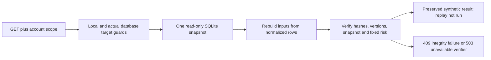

# B3B-R: verified synthetic CFD reads

This milestone implements only the four approved GET endpoints in the isolated CFD practice app. It adds no creation, amendment, deletion, lifecycle or replay-execution endpoint. Option A remains active: valid previews return **503 `calculation_runtime_unavailable`**, and accepted saving remains unavailable.

## What a read does

1. Apply the existing local-client, Host, Origin, header, rate and exact disposable-target guards before connecting.
2. Begin an explicit SQLite read transaction with `query_only=ON`. All account, head, revision, snapshot and child lookups use one consistent database snapshot.
3. Scope the position to the required `account_id`. Follow only the sealed ancestry of its published current head. A staged/unpublished revision is not historical evidence available through these endpoints.
4. Check current account identity against the frozen account contract, while retaining the historical display name. Check broker, platform, server/venue, instrument, product, currencies and the existing immutable snapshot fingerprint.
5. Verify canonical input/result/manifest bytes and hashes, recorded versions, calculation anchors and the original risk document. Reconstruct input independently from normalized execution, cost, FX and broker-evidence rows, including their account-scoped event keys. Compare that reconstruction with the saved canonical input.
6. Verify the original published page as an independent check on the frozen risk amounts before returning a later revision. Check quantity, cutoff, currency and reference correspondence with the preserved result. **Do not calculate PnL, exchange currencies or calculate R during GET.**
7. Validate the typed response. If any returned item fails verification, withhold the whole page with a safe error. Never repair data, refresh FX, call a calculator/container or write a receipt.



The response separates `integrity`, `provenance` and `replay`. Integrity reports stored-hash and normalized-input verification, with `result_correspondence: structural_checks_only` and `financial_recalculation: not_performed`. Provenance is always `synthetic_fixture`, with accepted calculation and broker authentication both false. Replay is `not_run`, with runtime unavailable. A hash check is not computational replay or proof of financial correctness.

Only `synthetic-read-json-v1`, the explicitly supported v1 request/result/risk schemas and the exact synthetic manifest are understood. This is **not** the future accepted-release canonicalizer or signature verifier. Unknown historical formats return 503 `historical_schema_unavailable`, withholding financial values. The optional preserved-only viewer proposed in the broader readiness plan is not implemented. B2 host/test manifests are not promoted into accepted releases.

Hashes refer to stored canonical bytes under their recorded format, not arbitrary browser `JSON.stringify` output. Typed HTTP presentation can spell UTC timestamps differently while preserving the same instant. Snapshot specification serialization and its v1 hash remain unchanged.

## Endpoints and pagination

| Method and path                                                                  | Result                                                                     |
| -------------------------------------------------------------------------------- | -------------------------------------------------------------------------- |
| GET `/api/v1/cfd/positions?account_id=...`                                       | Verified current published summaries, without combining account currencies |
| GET `/api/v1/cfd/positions/{position_id}?account_id=...`                         | Verified current preserved page                                            |
| GET `/api/v1/cfd/positions/{position_id}/revisions?account_id=...`               | Verified published revision metadata                                       |
| GET `/api/v1/cfd/positions/{position_id}/revisions/{revision_no}?account_id=...` | Verified selected historical/current page                                  |

Every route requires account scope. Foreign-account and missing-position requests both return a safe 404. Invalid fields are 422; duplicate/unknown query parameters or invalid cursors are 400; mismatched evidence is 409. Mutation methods on known paths are 405; unlisted mutation paths are 404. Responses use no-store and nosniff. Detail responses include the reviewed revision-specific ETag format; no editing protocol is enabled.

Page size defaults to 50, with a range of 1–100. Position keysets use ascending `(created_at, id)`; revision history uses ascending revision number. Cursors are bounded, HMAC protected, and bound to account, collection, parent position and page size. They expire when the app session changes. They are pagination instructions, **not authentication**. To change page size, start a fresh first page. Queries are capped at 2048 bytes and cursors at 800 characters; only documented query parameters are accepted.

The verifier bounds evidence to 32 MiB of combined canonical input/result/manifest, existing child-count limits and at most 1000 published revisions in a lineage. Larger histories fail closed; maximum-size performance has not been benchmarked. Lists return current published roots with explicit lifecycle metadata, not a sum of historical revisions.

## New synthetic fixture pages

The explicit runner creates a NEW owned temporary 0004 database on every launch. It adds four labelled teaching positions: three in one synthetic account and one in another server/account. Each has two published fixture revisions. No old Accounts workspace, journal or backup is opened or copied. There are **zero `cfd_requests` receipts**, and no public fixture-import route.

Fixture provisioning is restricted to the new registered engine before serving, with an empty ledger. It cannot reseed a ready workspace. Results are hand-declared constants; provisioning does not call the host calculator. Revision `amend` labels exist only to model historical pages in these new fixtures; no amendment service is implemented.

The USDJPY teaching specification uses a contract size of 100000, entry 150.000, original 0.10 lots and stop 149.800. These are **synthetic rules, not Bybit specifications**. Dated JPY-to-USD observations explicitly supply 0.005 USD per JPY for each relevant event; they are fictional teaching rates.

| Preserved page            | Stored teaching values                                                                                                                      |
| ------------------------- | ------------------------------------------------------------------------------------------------------------------------------------------- |
| Revision 1, partial       | 0.04 lots exit at 150.200; gross 800 JPY; entry commission -100 JPY; net 700 JPY / 3.50 USD; remaining 0.06 lots; 0.35R                     |
| Revision 2, closed        | Further 0.06 lots exit at 150.300; cumulative gross 2600 JPY; commission and swap total -200 JPY; net 2400 JPY / 12 USD; remaining 0; 1.20R |
| Original risk, both pages | 2000 JPY / 10 USD, with the same frozen risk hash; never replace original lots with remaining lots                                          |

These constants are inspectable fixtures, not accepted runtime outputs or broker-reconciled records. Existing backend formula tests still exercise the separate financial engines with synthetic inputs; this does not enable host calculation through the read or preview APIs.

## Run and test it yourself

From the repository root, using the existing environment:

```powershell
.\.venv\Scripts\python.exe services/api/scripts/cfd_practice.py
```

The runner binds only `127.0.0.1:8003` and prints a new temporary directory. It writes `read-catalog.json` containing only this session's synthetic account/position IDs, alongside the existing unsaved preview examples. It accepts no database path or resume argument. If the port is occupied, identify the conflict rather than stopping an unknown process. Normal shutdown removes only its verified new directory.

In another PowerShell 7 terminal, paste that newly printed directory:

```powershell
$cfdDirectory = 'PASTE THE NEW DIRECTORY PRINTED BY THIS RUNNER'
$cfdHeaders = @{ 'X-AVA-Local' = 'cfd-practice-v1' }
$cfdCatalog = Get-Content -LiteralPath (Join-Path $cfdDirectory 'read-catalog.json') -Raw | ConvertFrom-Json
$cfdRef = $cfdCatalog[0]
$cfdBase = 'http://127.0.0.1:8003/api/v1/cfd/positions'
$cfdCurrent = Invoke-RestMethod -Uri "${cfdBase}/$($cfdRef.position_id)?account_id=$($cfdRef.account_id)" -Headers $cfdHeaders
$cfdOld = Invoke-RestMethod -Uri "${cfdBase}/$($cfdRef.position_id)/revisions/1?account_id=$($cfdRef.account_id)" -Headers $cfdHeaders
$cfdCurrent.result.native.net_pnl
$cfdOld.result.native.net_pnl
$cfdCurrent.original_risk_sha256 -eq $cfdOld.original_risk_sha256
$cfdCurrent.provenance
$cfdCurrent.replay
```

Expect current net 2400 JPY, historical net 700 JPY, equal risk hashes, synthetic provenance and replay not run. Then request the collection with `account_id` and `limit=1`; follow its `next_cursor` with the same account and limit. Try another synthetic account ID against the first position: expect 404. A POST to `/positions` must be 405. Submit the runner's USDJPY preview example using the [B3A exercise](phase-2b-4b-b3a.md): it still must return 503 `calculation_runtime_unavailable`. Stop with Ctrl+C. These are owner exercises, not additional reported manual acceptance results.

## Implementation manifest

No models, migrations, crypto calculators, normal app routes, frontend source or dependency files changed.

| File                                             | Change                                                                                  |
| ------------------------------------------------ | --------------------------------------------------------------------------------------- |
| `services/api/app/api/cfd_reads.py`              | NEW: four GET routes, query rules and ETags                                             |
| `services/api/app/schemas/cfd_reads.py`          | NEW: typed reads/pages, risk anchor and explicit provenance/integrity/replay            |
| `services/api/app/services/cfd_records.py`       | NEW: scoped published retrieval and pagination                                          |
| `services/api/app/services/cfd_read_rows.py`     | NEW: independent reconstruction of normalized evidence                                  |
| `services/api/app/services/cfd_integrity.py`     | NEW: hashes, lineage, trusted identity, risk and structural correspondence checks       |
| `services/api/app/services/cfd_read_codec.py`    | NEW: bounded canonical synthetic evidence and version markers                           |
| `services/api/app/services/cfd_cursor.py`        | NEW: bounded session-local signed cursors                                               |
| `services/api/app/services/cfd_read_fixtures.py` | NEW: restricted fresh-workspace provisioning of hand-declared examples                  |
| `services/api/tests/test_cfd_reads.py`           | NEW: read/integrity/isolation/transport/no-write regressions                            |
| `services/api/tests/cfd_read_attacks.py`         | NEW: intentional corruption only in new pre-serving adversarial fixtures                |
| `services/api/app/cfd_practice.py`               | Register read router and generate a session-local cursor key                            |
| `services/api/app/core/cfd_access.py`            | Allow exactly the new GET paths; cap query size                                         |
| `services/api/app/core/cfd_errors.py`            | Recognize sanitized pagination field paths                                              |
| `services/api/app/database/cfd_session.py`       | Explicit consistent read transaction; provision new fixtures; explicit integrity checks |
| `services/api/app/schemas/cfd_api.py`            | Report synthetic read capability; saving/preview execution stay disabled                |
| `services/api/scripts/cfd_practice.py`           | Print fixture notice and write new session's read catalog                               |
| `services/api/tests/test_cfd_preview_api.py`     | Update approved route/status expectations without weakening runtime protections         |
| `docs/phase-2b-4b-b3b-r.md`                      | NEW: this implementation, exercise and validation report                                |
| `docs/phase-2b-4b-b3-readiness.md`               | Record read-only subset approval and link implementation report                         |
| `docs/phase-2b-4b-b3a.md`                        | Clarify historical B3A behavior versus the later approved synthetic reads               |
| `docs/learning-journal.md`                       | Append GET, read-only, hashes and historical evidence lesson                            |

## Validation

Tests used newly created disposable/in-memory databases only. Protected databases were not opened or hashed to establish preservation. These are local validation results; no push or new GitHub Actions run is included.

| Check                                                                       | Final result                                                                         |
| --------------------------------------------------------------------------- | ------------------------------------------------------------------------------------ |
| Full backend regression suite                                               | **PASS: 695 tests**, including 65 new B3B-R tests and all 630 prior regressions      |
| Read integrity, isolation, pagination and no-write/no-execution boundaries  | **PASS**, included in the 65 new tests                                               |
| Migration, recovery/rollback, constraint/concurrency and crypto regressions | **PASS**, included in the full backend suite; disposable targets only                |
| Python Ruff lint                                                            | **PASS**, all checks passed                                                          |
| Python formatting                                                           | **PASS**, 110 files already formatted                                                |
| Frontend ESLint                                                             | **PASS**, exit 0                                                                     |
| TypeScript                                                                  | **PASS**, route generation and `tsc --noEmit`                                        |
| Production build                                                            | **PASS**, isolated build configuration with `AVA_E2E=1` and unreachable API on 59999 |
| Desktop/mobile browser regression                                           | **PASS: 14 tests** on the browser launcher's fresh disposable environment            |
| Repository Prettier formatting                                              | **PASS**, all matched files use Prettier style                                       |
| PostgreSQL                                                                  | **SKIPPED / UNVERIFIED**, no safe PostgreSQL environment used                        |
| Approved container execution, signing and historical replay                 | **SKIPPED / UNVERIFIED**, no approved operational runtime installed or activated     |
| Owner manual B3B-R acceptance                                               | **NOT YET REPORTED**, exercise supplied above                                        |

Reproduce from the repository root, in a separate verification terminal:

```powershell
.\.venv\Scripts\python.exe -m pytest services/api/tests -q -x
.\.venv\Scripts\python.exe -m ruff check services/api
.\.venv\Scripts\python.exe -m ruff format --check services/api
npm run lint
$env:AVA_E2E = '1'
$env:API_BASE_URL = 'http://127.0.0.1:59999'
npm run typecheck
npm run build
npm run test:e2e
npm run format:check
```

Run type generation/build and browser checks sequentially because they share test build directories. The browser launcher pins its own API at 8001 and web app at 3100, refuses to reuse an existing server and does not connect to the normal journal or Accounts practice session. One existing FastAPI test-client HTTPX deprecation warning and browser color/reduced-motion notices remain; they did not fail checks.

Backend testing passed **695 tests**, including **65 new B3B-R tests** and all 630 prior regressions. Coverage includes current/history retrieval; cursor/account/collection/session binding; foreign-account requests; unpublished/unsealed revisions; snapshot/input/result/manifest tampering; unsupported versions; fixed original risk; read-only SQL; no calculator/process execution; disabled mutations; actual-target rejection; and retained B3A 503 behavior. Existing migration, rollback, concurrency and crypto tests also passed.

The first expanded run stopped at 37 passes with one test-setup error: a Python dictionary constructor received `account_id` twice before making an HTTP request. Dictionary merging was corrected, and the complete suite subsequently passed. No unexpected integrity-boundary or migration failure occurred. Ruff's initial long-line/import findings were corrected by formatting/import sorting before final checks.

Adversarial tests deliberately remove database triggers **only inside their newly created synthetic fixture**, before serving, to simulate privileged database tampering and exercise independent read verification. Actual schema/trigger definitions and application guards are unchanged. No security/validation hook is disabled. Successful adversarial tests prove withholding and no repair; they do not certify protection against a privileged owner who rewrites every artifact and fingerprint coherently.

The normal journal, preserved backups and existing practice account records remain untouched. `.vscode/` remains untracked and untouched. No container runtime, broker integration, deployment or push is included.

## Limits and next approval

Hash verification is not an independent mathematical audit. Without an approved signed release and computational replay, numerical correctness cannot be established merely from a self-consistent result/hash pair. The API labels structural checks separately and supports only known synthetic fixture evidence. No real broker-statement reconciliation is claimed.

The local header and account IDs are not authentication. Real multiuser/private production access requires a separately reviewed ownership/authentication model. Maximum-size capacity, PostgreSQL execution, signed-release validation and historical container replay remain unverified. Unknown historical verifiers fail closed rather than being silently interpreted as current models.

Next proposed stage: **runtime readiness and accepted-save design review**, followed by separately authorized gated creation implementation. Review Windows/WSL/hardware/resource requirements and journal isolation; signing authority, algorithm, pinned keys, release approval/retirement and retained verifier/artifact archive; offline execution controls; golden results and historical replay. Installation and release activation need separate approval. Only afterward should accepted creation be enabled and tested through atomic graph/head/receipt publication, immutable risk, account-scoped idempotency, collision/concurrency handling, failure injection and uncertain-commit recovery. No such work is authorized by completion of B3B-R.
