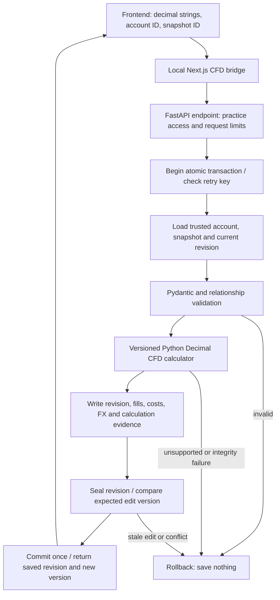

# Milestone 2B.4B — CFD persistence design review

Date: **2026-10-17**. Status: **proposal only; implementation and all migrations are NOT authorized**. No models, API features, migration files or databases are changed by this document. 2B.4A is [accepted on eight owner-reported manual passes](phase-2b-4a-acceptance.md).

Review update: the owner conditionally accepts the architectural direction, **not implementation or final B1 sign-off**. The [B1 design addendum](phase-2b-4b-b1-addendum.md) answers the seven open questions and takes precedence on scope guards, native R, sizing, release artifacts, reduced scope and concurrency tests. In particular, proposed 0004 also adds CFD-reference guards to existing account/instrument tables without changing their rows or migration 0003. B1, B2 and B3 remain separate approvals.

## 1. Recommendation and boundaries

Create a separate, versioned CFD ledger using existing account/instrument identities and the tested partial-position engine. Keep the crypto `trades`/`trade_exits` path unchanged. Support one original entry and multiple exits; no scale-ins, broker connections, automatic execution, account balances or combined equity calculations in this milestone.

**Revision 0003 is not sufficient for CFD trade persistence.** It creates `journal_accounts`, `instruments`, `instrument_snapshots`, `broker_import_batches` and `trade_contexts`. The first four provide reusable identities/provenance. `trade_contexts` specifically links legacy `trades` rows; it is not a CFD ledger. None stores CFD lot executions, signed costs, dated conversions or reproducible position revisions.

Recommend a single additive **0004**, after separate explicit approval, to create ten CFD-only tables, their indexes and protective triggers described below. It would insert **zero journal records**, update **zero existing business rows**, assign **zero historical accounts**, and leave all existing business tables/IDs/calculators/screenshots intact. The existing Alembic revision metadata would advance from 0003 to 0004; that is not a financial-record change. Existing records have no new required columns or backfill. Normal-database application requires another, separate approval even after disposable implementation/rehearsals are approved.

The extra tables serve distinct purposes: stable position identity, editable current pointer, immutable history, event identity, four types of financial evidence, saved calculation evidence, and retry protection. Implement them in small reviewed steps rather than building CFD forms at the same time.

## 2. Beginner picture: the folder, pages and service desk

An account is a folder. A position is a trade file in that folder. A specification snapshot is the exact dated rule card used for that trade. Revisions are numbered pages: corrections add a page; they do not erase earlier pages. The head pointer is a bookmark identifying the current page.

A **primary key (PK)** is a record's unique ID. A **foreign key (FK)** makes another record point to a real, compatible record. A **unique constraint** prevents repeated identities. A **check constraint** rejects prohibited values. These work alongside Python validation rather than replacing it.

An **API endpoint** is a named service desk for a request. An **atomic transaction** means the whole save succeeds or none of it does—like submitting a complete sealed envelope, not leaving half its pages on the counter. No network call occurs inside a save transaction.

## 3. Common types and enforcement rules

The following is a logical schema specification, not executable DDL. Columns are required unless marked `?`. All FKs use `ON DELETE RESTRICT`; no financial history cascades away. IDs generated by the service are UUID strings `U = VARCHAR(36)`; references to existing accounts/instruments are `I = VARCHAR(100)`. Logical event IDs are `I`, validated nonblank, with UUIDs recommended for manual creation. Currency `C = VARCHAR(12)` follows the current uppercase currency contract. `H = VARCHAR(64)` is a lowercase SHA-256 hex digest.

`D` means canonical finite Decimal **TEXT**, bounded to 128 characters for input fields, validated by the existing FinancialDecimal rules (at most 38 digits / 18 fractional places and existing field-specific ranges). Preserve money/price/quantity as decimal strings through JSON, SQLAlchemy and storage. Do not use SQLite REAL, SQL casts to REAL, SQL SUM over text, or JavaScript Number for authoritative accounting. Prefer text consistently on PostgreSQL too for this first portable ledger; native PostgreSQL NUMERIC can be considered later through its own reviewed migration. Exact derived results can exceed input precision and stay in result documents without a `NUMERIC(38,18)` restriction. SQLite floating point is approximate; PostgreSQL offers exact NUMERIC, but cross-database storage must still be intentional. [SQLite floating point](https://www.sqlite.org/floatingpoint.html), [PostgreSQL numeric types](https://www.postgresql.org/docs/current/datatype-numeric.html).

Canonical decimal encoding uses plain base-10 notation, no exponent, no leading plus sign, no unnecessary leading/trailing zeros and one spelling of zero. Decimal representation is normalized without float conversion or context-dependent rounding. Request hashing uses this normalized, schema-versioned representation, not the browser's raw formatting. Existing instrument snapshot hashes keep their existing canonicalization unchanged; never rehash/rewrite old specifications under a new rule.

`T` means fixed-width UTC ISO text with six fractional second digits and `Z`. Convert aware offsets to UTC, reject timezone-free/numeric dates, and reject precision beyond microseconds at the persistence boundary rather than silently truncating it. Use server-generated UTC instants for audit times; financial instants are explicitly supplied. Stable execution ordering is `(executed_at, ordinal, execution_id)`; ordinal resolves equal timestamps. No broker-local timezone is guessed.

`J` means canonical UTF-8 JSON **TEXT** with schema version, sorted keys and deterministic separators; financial values are strings, unavailable values are null plus explicit reasons. JSON hashes detect alteration; they do not authenticate a broker. Documents have explicit size/depth limits. Proposed limits are 4 MiB per command and 32 MiB combined canonical input/result evidence per save, with existing engine ledger cardinality limits retained. Reject oversize documents; never truncate. Confirm limits against maximum synthetic ledgers during implementation review.

SQL enforces PK/FK/unique/enum/shape constraints, immutability and head-publication rules. Python enforces exact Decimal ranges, grid arithmetic, temporal coverage, hashes, calculation compatibility and cross-row lot totals. A generic SQL TEXT column or length check does **not** independently prove a valid decimal. No direct SQL data-entry API is supported.

## 4. Proposed tables, columns and relationships

### 4.1 `cfd_positions` — immutable original identity and risk anchor

| Columns                                                         | Type / purpose                                                                                                                                              |
| --------------------------------------------------------------- | ----------------------------------------------------------------------------------------------------------------------------------------------------------- |
| `id`                                                            | U PK; stable position reference supplied to the calculator                                                                                                  |
| `account_id`, `broker`, `settlement_currency`                   | I, I, C; composite FK to `journal_accounts(id, broker, settlement_currency)`                                                                                |
| `snapshot_id`, `instrument_id`                                  | U, I; with broker/settlement, composite FK to `instrument_snapshots(id, instrument_id, broker, settlement_currency)`                                        |
| `snapshot_sha256`                                               | H; exact referenced specification hash, independently checked on save/load                                                                                  |
| `account_contract`, `account_sha256`                            | J, H; frozen account identity/reporting currency used for historical calculation                                                                            |
| `direction`                                                     | `buy` or `sell`                                                                                                                                             |
| `original_entry_id`, `entry_at`, `entry_price`, `original_lots` | I, T, positive D, positive D; fixed original execution anchor                                                                                               |
| `original_stop`                                                 | positive D?; missing stop stays missing and produces unavailable original risk/R                                                                            |
| `original_risk_basis`, `original_risk_sha256`                   | J, H; entry/specification/stop/entry-time risk FX, reporting policy, risk rounding/version and original native/reporting risk values or unavailable reasons |
| `import_batch_id`                                               | U?; composite FK `(import_batch_id, account_id)` to existing `broker_import_batches(id, account_id)`; null for manual records                               |
| `source`, `created_at`                                          | J financial source metadata, T audit time; manual provenance for this milestone                                                                             |
| `replaces_position_id`                                          | U? FK to `cfd_positions.id`; explicit reviewed replacement linkage, never a silent reassignment                                                             |

Unique `(id, account_id)` supports scoped child FKs. Check positive input shape, direction, currency/hash formats, and `replaces_position_id != id`. The service prevents replacement cycles; only a voided predecessor can be replaced. Each root is immutable after insertion. Enforce CFD product, allowed platform (manual/MT5), broker/server/settlement compatibility and supported mode using trusted snapshot/account loading; proposed SQL insert guards additionally reject a referenced non-CFD instrument and mismatched stored scope. Mode support is decided by the versioned engine, not invented by SQL.

An original entry is also represented in each complete revision's execution list. This deliberate duplication is checked against the immutable root before sealing; it cannot become a second entry or a second PnL contribution. `original_entry_id` is an anchor, not a circular FK to a future child row.

### 4.2 `cfd_revisions` — immutable complete ledger versions

| Columns                                             | Type / purpose                                                                                         |
| --------------------------------------------------- | ------------------------------------------------------------------------------------------------------ |
| `id`, `position_id`, `account_id`                   | U PK; scoped composite FK to `cfd_positions(id, account_id)`                                           |
| `revision_no`, `parent_revision_id`                 | positive INTEGER; U? scoped FK `(parent_revision_id, position_id)` to `cfd_revisions(id, position_id)` |
| `operation`, `lifecycle`                            | `create/amend/archive/restore/void`; `active/archived/void`                                            |
| `reason`, `notes`                                   | VARCHAR(500), bounded TEXT?; nonblank reason mandatory for amendments/lifecycle operations             |
| `planned_take_profit`                               | positive D?; recorded plan, no recalculation of original risk                                          |
| `as_of`, `reporting_policy`, `recognition_policy`   | T; `native_only/explicit_rates`; `incurred_once`                                                       |
| `rounding_policy`, `changed_event_ids`              | J per-currency/ratio/movement rounding; J explicit correction audit references                         |
| `request_schema_version`, `created_at`, `sealed_at` | VARCHAR(64), T, T?; seal is an internal construction step                                              |

Unique `(position_id, revision_no)`, `(id, position_id)`, `(id, position_id, account_id)`. First revision has no parent and number 1; later revisions must reference the preceding current revision in the same position. Enforce sequence at service/sealing and head publication, not just FK existence. Revisions copy the **complete effective ledger**, not increments to sum across history. A new revision does not recognize all historical costs again.

### 4.3 `cfd_position_heads` — current bookmark and edit version

| Columns                      | Type / purpose                                                                                                                               |
| ---------------------------- | -------------------------------------------------------------------------------------------------------------------------------------------- |
| `position_id`                | U PK / FK to `cfd_positions.id`                                                                                                              |
| `revision_id`, `revision_no` | U, positive INTEGER; scoped FK `(revision_id, position_id)` to the revision; same revision ID also FK to the unique calculation evidence row |
| `row_version`, `updated_at`  | positive INTEGER, T; monotonically increasing compare-and-swap version                                                                       |

Require `row_version = revision_no` and matching referenced revision number. This is the sole mutable business table. Publication guard requires a sealed revision with calculation evidence and the expected parent; an existing head advances exactly one revision. New roots and revisions are created in one transaction; readers list only roots with published heads. An unheaded root is not an accepted trade.

### 4.4 `cfd_event_keys` — stable identities and duplicate protection

| Columns                                          | Type / purpose                                                            |
| ------------------------------------------------ | ------------------------------------------------------------------------- |
| `account_id`, `kind`, `event_id`                 | composite PK; kind `execution/adjustment/conversion/evidence`; I event ID |
| `position_id`, `first_revision_no`, `created_at` | U scoped FK to root, positive INTEGER, T                                  |

Unique `(account_id, kind, event_id, position_id)` supports scoped references from ledger rows. A key is append-only and belongs to one position. The same ID may appear in that position's later complete revisions; it cannot be reused to create another position in the account. A repeated event in one revision is rejected by child PKs and Pydantic. IDs for different accounts may coincide without mixing records.

These are internal logical IDs, not automatically verified broker deal IDs. Future imports need adapter-specific external identity/replacement-chain rules before using real broker IDs. New random IDs can still disguise the same economic trade; idempotency is not magical duplicate detection. Shared rate observations may be copied under new position-local logical IDs with the same supplied source facts; no new rate is inferred.

### 4.5 `cfd_executions` — entry and partial exits

| Columns                                   | Type / purpose                                                             |
| ----------------------------------------- | -------------------------------------------------------------------------- |
| `revision_id`, `execution_id`             | composite PK U/I                                                           |
| `position_id`, `account_id`, `event_kind` | scoped FK to revision and event key; event_kind fixed `execution`          |
| `role`, `ordinal`                         | `entry/exit`; nonnegative INTEGER, unique `(revision_id, ordinal)`         |
| `executed_at`, `price`, `lots`            | T, positive D, positive D                                                  |
| `profit_conversion_id`                    | I? FK `(revision_id, profit_conversion_id)` to that revision's conversions |

Unique filtered index allows at most one entry per revision; sealing requires exactly one and verifies it equals the original root entry. Entry has ordinal 0 and no realized-profit conversion. Exits have positive ordinals, ordered instants and valid tick/lot grids. Sum of exits across the **whole saved ledger**, including deferred fills, cannot exceed original lots. Remaining lots and realized state are derived, not independently editable columns.

### 4.6 `cfd_adjustments` — signed costs and credits

| Columns                                     | Type / purpose                                                          |
| ------------------------------------------- | ----------------------------------------------------------------------- |
| `revision_id`, `adjustment_id`              | composite PK U/I                                                        |
| `position_id`, `account_id`, `event_kind`   | scoped revision/key FKs; kind fixed `adjustment`                        |
| `kind`, `amount`, `currency`, `occurred_at` | `commission/swap/fee/other`, signed D, C, T                             |
| `execution_id`, `conversion_id`             | I? each; composite FKs within the same revision to execution/conversion |
| `description`, `source`                     | VARCHAR(300) nonblank, J `FinancialSource`                              |

Negative amount is a charge; positive is a credit. An entry commission is one adjustment linked to the entry ID; exit commissions link to their exits. Swaps can be position-level with no execution link. There are no additional fee columns on executions to deduct the same charge again. Preserve source facts and each adjustment's own currency/time.

### 4.7 `cfd_conversions` — supplied dated rates

| Columns                                        | Type / purpose                                                     |
| ---------------------------------------------- | ------------------------------------------------------------------ |
| `revision_id`, `conversion_id`                 | composite PK U/I                                                   |
| `position_id`, `account_id`, `event_kind`      | scoped revision/key FKs; kind fixed `conversion`                   |
| `from_currency`, `to_currency`, `rate`         | C, C, positive D; target units per ONE source unit                 |
| `observed_at`, `applies_at`, `max_age_seconds` | T, T, INTEGER 0–31536000                                           |
| `source`                                       | J source kind/reference; recorded, not automatically authenticated |

Check currencies differ, observation is not later than application and age respects the explicitly supplied bound. Python validates that each reference's direction, target currency and application instant match the cash flow; unreferenced observations are rejected by the existing contract. A risk conversion is retained in the immutable root basis and included identically in every revision when required; it must also reference a conversion in that revision at sealing. SQL ensures revision-local targets; Python proves financial coverage.

### 4.8 `cfd_broker_evidence` — reported values kept separate

| Columns                                                        | Type / purpose                                                                                |
| -------------------------------------------------------------- | --------------------------------------------------------------------------------------------- |
| `revision_id`, `evidence_id`                                   | composite PK U/I                                                                              |
| `position_id`, `account_id`, `event_kind`                      | scoped revision/key FKs; kind fixed `evidence`                                                |
| `instrument_id`, `position_reference`                          | I, U; must equal trusted root scope at sealing                                                |
| `original_lots`, `exited_lots`                                 | positive D?, nonnegative D?                                                                   |
| `state`, `as_of`, `reported_at`                                | `open/partial/closed`, T, T                                                                   |
| `basis`, `recognition_policy`, `metric`                        | `native/reporting`; `incurred_once/other/unknown`; existing `BrokerReportedValue` metric enum |
| `amount`, `currency`, `comparison_basis`, `absolute_tolerance` | signed D, C, `raw/display_rounded`, nonnegative D                                             |
| `source`                                                       | J source kind/reference                                                                       |

Check report time is not before its declared cutoff. Preserve supplied evidence and compare under the existing scope/quantity/currency/time/policy rules. A mismatch produces a difference or unavailable comparison; reported PnL never fills a missing calculated amount. No real-statement reconciliation is claimed from synthetic agreement.

### 4.9 `cfd_calculations` — reproducible accepted evidence

| Columns                                                  | Type / purpose                                                                                   |
| -------------------------------------------------------- | ------------------------------------------------------------------------------------------------ |
| `revision_id`                                            | U PK; with `position_id`, scoped FK to revision                                                  |
| `position_id`, `snapshot_sha256`, `original_risk_sha256` | U, H, H; expected root anchors                                                                   |
| `canonical_input`, `input_sha256`                        | J full reconstructed `CfdPositionRequest`, H                                                     |
| `canonical_result`, `result_sha256`                      | J full typed result including unavailable fields/comparisons, H                                  |
| `engine_id`, `engine_build_sha256`, `policy_version`     | VARCHAR(64), H, VARCHAR(64); e.g. `cfd-position-v1`, exact approved build and `incurred-once-v1` |
| `canonicalizer_version`, `manifest`, `manifest_sha256`   | VARCHAR(64), J, H; contracts, Python/Decimal context, dependency lock/build identity             |
| `calculated_at`                                          | T server audit timestamp, separate from financial `as_of`                                        |

Result documents preserve raw and display-rounded amounts, currencies, reasons and ratios. Do not store authoritative SQL float PnL caches. The record stores both policy names and complete policy contents; an enum label alone is not enough for reproduction. Comparison evidence and its result remain distinguishable within the envelope.

The build manifest must cover the actual calculator modules, request/result contracts, canonicalizer and dependency lock identity. Store all replay-affecting manifest contents, not just a mutable version label. Historical replay uses the frozen account contract; a later display-name or reporting-setting change must never relabel historical money. Current account lookup still verifies access and root identity, but does not replace the preserved calculation contract.

### 4.10 `cfd_requests` — committed idempotency receipts

| Columns                                          | Type / purpose                                                                                    |
| ------------------------------------------------ | ------------------------------------------------------------------------------------------------- |
| `id`, `account_id`, `idempotency_key`            | U PK, I FK to account, nonblank VARCHAR(100)                                                      |
| `operation`, `resource_id`, `revision_id`        | bounded enum, U, U; scoped FK to the exact resulting position/revision in this account            |
| `request_sha256`, `request_schema_version`       | H, VARCHAR(64); hash includes operation/resource/account, expected version and normalized command |
| `response_status`, `response_body`, `created_at` | allowed successful INTEGER status, J immutable receipt, T                                         |

Unique `(account_id, idempotency_key)` across all mutation operations. Only completed successful receipts are committed with the ledger. A replay returns the original revision/response, explicitly marked as a replay; it does not pretend to be the latest revision. Retain keys with retained history; no automatic expiry enabling later duplicate saves. Failed validations reserve no persistent key.

## 5. Immutability, ordering and constraint mechanics

Create parents first: position, revision, event keys, conversions, executions, adjustments/evidence, calculation, seal, head and request receipt. Child tables carry `(revision_id, position_id, account_id)` FKs to prevent cross-position joins. Child event references include `(account_id, event_kind, event_id, position_id)`. Add indexes on account/created-time, position/revision number, snapshot, and every frequently checked referencing FK. Existing 0003 composite unique keys supply the account/snapshot/import FK targets without altering those tables.

All new tables except heads are append-only; revision sealing is the one narrow exception. New revision `sealed_at` starts null inside the transaction; its only permitted UPDATE sets that field once, leaves all other columns unchanged and requires its calculation evidence. Child INSERT is allowed only while the parent revision is unsealed; UPDATE/DELETE is forbidden. After sealing, no additional fills, costs or evidence can be slipped into that revision. Event keys, roots, receipts and calculations reject UPDATE/DELETE too. Head guards require sealed evidence, correct parent and version increment.

The service performs full aggregate validation before sealing. Portable SQL cannot prove all Decimal totals and canonical-document equivalence alone. A rogue raw SQL client could commit an unfinished, unheaded construction; it remains unpublished, is rejected by read/replay verification and must be reported, not adopted as valid history. Tests must distinguish database guards from trusted-service invariants. No ordinary API can expose or save such a construction successfully.

SQLite needs FK enforcement on **every** connection; retain the existing connect listener and verify it. Use dialect-specific SQLite/PostgreSQL trigger implementations, tested independently. PostgreSQL trigger functions must be new CFD-specific objects; never alter the existing snapshot functions. Both dialects use immediate FK order rather than relying on deferred circular relationships. [SQLite FK documentation](https://www.sqlite.org/foreignkeys.html).

## 6. Original risk, costs and conversion policy

For supported linear modes, retain the existing engine's gross exit calculation: direction sign × (exit price − original entry price) × exited lots × recorded contract size. The instrument's declared mode/category must be supported; never apply this formula to an unsupported tick-mode contract. Leverage does not multiply profit again. Actual execution prices already carry spread effects; no automatic spread deduction is added.

At creation freeze original native planned risk: `abs(entry price − original stop) × original lots × recorded contract size`, plus its original entry-time reporting conversion if supplied. Store both the input basis and result/reason. Never replace original lots with remaining lots, move the original stop after an exit, switch to a newer snapshot, or use today's FX for the risk denominator.

Missing stop or native-only policy can make risk/R unavailable. Preserve that original unavailable state; later reporting evidence must not silently manufacture a new original denominator. Correcting a genuinely wrong original entry/stop/snapshot/account/risk FX requires a linked void-and-replacement operation, not an ordinary amendment. Current stop updates, portfolio risk estimates and alternative valuation views are outside this milestone.

`incurred_once` recognizes each charge/credit in full at its supplied occurrence time up to `as_of`, including an entry commission while the position is open. There is no proportional allocation of entry fees across exits in this policy. Rebuilding one effective revision counts each adjustment once; historical revision copies are never summed. Costs in mixed currencies remain separately labelled; native or reporting net can remain unavailable where the existing engine lacks appropriate coverage. Do not create an inverse rate or USD/USDT parity to fill the gap.

`native_only` retains native observations and leaves cross-currency totals unavailable. `explicit_rates` requires all references demanded by the existing input contract, including original-risk FX at entry, each exit at its execution time and each cost at its occurrence time. Invalid/incomplete `explicit_rates` requests are rejected; users may explicitly select `native_only` where appropriate. Never silently switch policies. Per-currency rounding mode/places and ratio/movement places are recorded. Risk-relevant rounding/reporting policy is fixed for the position; corrections require replacement.

State and remaining lots are computed at the saved `as_of`, which is explicit rather than silently moving with the clock. Later events may exist in the complete ledger but remain deferred; total-lot validation still covers them. Partial realized R uses cumulative recognized net divided by fixed original risk. It is not an R multiple for only the closed slice, and partial/open records are not classified as completed wins/losses. Unrealized PnL remains unavailable without a separate valuation contract.

## 7. Save, reload and exact reproduction

1. Resolve actual stored account/snapshot IDs, verify snapshot hash/scope and build the frozen root basis. Browser-supplied embedded specifications/hashes/results are not authority.
2. Validate a complete ledger under the approved contracts. Run the unchanged CFD engine using its own 160-digit Decimal context and explicit rounding; retain per-field unavailable reasons. Reject unsupported modes, invalid input, missing rounding definitions and numeric failures rather than accepting an uncalculable root.
3. Normalize exact inputs, persist all child rows and assemble the canonical input **from the persisted representations**. Verify it equals the validated canonical request; calculate/store the canonical result, version/build manifest and hashes; verify the risk anchor; seal and publish atomically.
4. On reload, verify root/snapshot/account hashes, revision relationships and child-document equality, then show the preserved accepted calculation labelled with its revision, `as_of` and engine identity. GET does not recalculate with today's rates or silently write another revision.
5. A read-only replay reconstructs from the normalized rows and frozen account/specification, uses the exact approved calculator build/contracts/policy/canonicalizer and compares the full result hash. Differences are an integrity/reproducibility failure, not an automatic overwrite. Corrupt evidence produces a safe unavailable error and is excluded from analytics.

Retain the approved calculator source/build and dependency manifest in private reproducibility artifacts or an approved reproducible release process. A Git commit hash alone does not guarantee the runtime is available. Never download/execute arbitrary uploaded calculator code. If the historical runtime is unavailable, label the preserved result as stored evidence with replay unavailable; do not claim successful reproduction. A future engine upgrade needs a separate reviewed recalculation policy; old results remain untouched.

Synthetic anchor: EURUSD 0.10 lots at 1.10000, contract 100000, stop 1.09800; close 0.04 at 1.10200 then 0.06 at 1.10300. Expect 8 + 18 = 26 USD gross, 20 USD original risk, 1.30R with no costs. Four distinct incurred USD costs totaling −4 give 22 USD net / 1.10R. At the first-exit cutoff, gross is 8 and remaining lots 0.06; only costs already incurred at that cutoff count.

## 8. Retry protection and conflicting edits

**Idempotency** is like a numbered receipt: resending the same order to the filing desk returns the original receipt, not another trade. Every mutation requires a caller-generated `Idempotency-Key`, account scope and canonical request hash. Same key/same command returns its immutable successful receipt. Same key/different command returns 409 with no writes. Check for a committed matching receipt before rejecting a stale expected version, so a legitimate retry of an earlier success still works.

**Optimistic concurrency** is like checking a page number before writing: if two tabs open version 3, the first may save version 4; the second must reload instead of overwriting it. GET returns an ETag derived from position ID/version. Amend/archive/restore/void/replace require `If-Match`; missing precondition returns 428, stale version 412. The transaction updates the head with `WHERE position_id = supplied_id AND row_version = expected_version`; exactly one affected row is required. Do not rely on a Python pre-check alone or assume ORM bulk updates automatically perform version checks. [SQLAlchemy version counter caveats](https://docs.sqlalchemy.org/en/20/orm/versioning.html).

If a unique-key race or failed CAS occurs, roll back the **whole** attempt, then re-read the committed idempotency receipt: matching command replays; conflicting key returns 409; absent receipt/stale head returns 412. SQLite write contention is bounded and may return 503/retry guidance; no unchecked retry can bypass CAS. Retry the same key after uncertain network outcomes. PostgreSQL uses the same CAS semantics, not a last-write-wins overwrite.

For SQLite saves, propose an explicit `BEGIN IMMEDIATE` write transaction before authoritative head/identity validation, avoiding an unsafe read-to-write upgrade race. Keep it short and bounded; never make broker/network calls while holding the write lock. PostgreSQL uses its transaction plus the conditional head UPDATE. Both paths require the expected-version comparison even when database locking serializes writers.

## 9. Proposed API contract and correction/retention policy

All routes below are future local-practice endpoints under `/api/v1/cfd`; none exists because this document was written. The Next bridge must explicitly allowlist them and retain loopback, same-origin, timeout, body-size and no-store controls. Require an explicit account scope on every operation and verify the position belongs to it before returning data. This is account separation within one local workspace, not production per-user authorization.

For creation/preview, propose a caller-generated draft UUID as `position_reference`, chosen once and retained on retries. The server validates it and rejects collisions; revision/snapshot persistence IDs remain server generated. This lets comparison evidence name the intended position before its first save. A draft ID is not proof of ownership or an accepted record. The request hash includes it, and the normal account/snapshot lookups still determine authority. Preview stores nothing. Replacement uses a new draft UUID and, when correcting account choice, a separately explicit `replacement_account_id`; both scopes must be validated before the atomic operation.

| Operation                                                   | Purpose / proposed behavior                                                                                                                                                                                                                      |
| ----------------------------------------------------------- | ------------------------------------------------------------------------------------------------------------------------------------------------------------------------------------------------------------------------------------------------ |
| `POST /preview`                                             | Read trusted identities, validate and calculate; no ledger writes or accepted revision. A preview response is not a saved trade.                                                                                                                 |
| `POST /positions`                                           | Create root plus complete revision 1 and receipt; 201. Requires account/snapshot IDs and idempotency key.                                                                                                                                        |
| `GET /positions?account_id=...`                             | Paginated current published roots in that account; archived/void excluded by default with explicit filters. No mixed-currency sums.                                                                                                              |
| `GET /positions/{id}?account_id=...`                        | Current frozen input/result and ETag, scope checked.                                                                                                                                                                                             |
| `GET /positions/{id}/revisions[/{revision}]?account_id=...` | Immutable history; old revisions are visibly historical.                                                                                                                                                                                         |
| `POST /positions/{id}/revisions`                            | Complete amended ledger plus mandatory correction reason; creates next revision, never edits old children. Requires account scope, key and If-Match.                                                                                             |
| `POST /positions/{id}/archive`, `/restore`                  | New lifecycle revision with reason; restore only archived records. Retain all evidence.                                                                                                                                                          |
| `POST /positions/{id}/void`                                 | Mark erroneous trade excluded through a new terminal lifecycle revision; preserve evidence/reason. No silent resurrection.                                                                                                                       |
| `POST /positions/{id}/replace`                              | Explicit correction of immutable root facts: atomically void active predecessor and create linked replacement; archived/previously void records cannot be replaced by this first version. Requires reviewed new inputs and predecessor If-Match. |
| `POST /positions/{id}/replay`                               | Read-only deterministic verification for an explicitly selected revision; no ledger mutation or automatic recalculation history.                                                                                                                 |
| `DELETE /positions/{id}`                                    | Not supported (405). “Archive” is the reversible hide action; it is not erasure.                                                                                                                                                                 |

Include account scope in mutation bodies, with the URL position as the resource. Successful mutations return the saved revision and version; archive/void do not change what the calculator previously observed, only inclusion status. Invalid financial fields return 422; missing/incompatible scoped resources return safe 404/422 as appropriate without revealing another scope's records. No generic ORM serialization of private/internal fields or credentials.

Archive/restore/void clone the preceding financial ledger, policies and `as_of` unchanged; their only new business facts are lifecycle/reason/audit metadata. Do not substitute the current clock as the financial cutoff. An ordinary amendment must state its intended cutoff explicitly. Changing that cutoff remains an auditable revision, not an invisible GET-time update.

Notes, take-profit plan, exits, incurred adjustments, non-risk conversions and reported comparison evidence can be corrected through a new complete revision with reason/changed IDs. Account, snapshot, original entry/direction/lots/stop/risk basis and risk policy cannot change within a position. Stable logical event IDs identify corrections, not new charges. Removing a mistaken cost from the next effective ledger is allowed only as a documented correction; the earlier page retains it. Closed positions may need genuine statement corrections; reopening is not inferred from a late price feed.

A replacement gets new logical event IDs with explicit old-to-new references in correction metadata; historical event keys are not reassigned. No real broker import identity policy is implied. Replacement and predecessor voiding share one transaction and one idempotency receipt scoped to the operation; both resulting revision IDs and the replacement ID are preserved in the receipt body. Its primary resource/revision FK identifies the predecessor's void revision. Any failure restores both prior states.

No hard purge, automatic retention expiry, anonymization or attachment copying is included. All accepted revisions, costs, FX, broker evidence, receipts and build manifests are retained for the lifetime of the journal dataset; disclose this before saving. A later privacy purge/export policy needs separate review. Temporary practice databases remain disposable as before. CFD screenshots are deferred until ownership/lifecycle design; legacy screenshots are never touched.

## 10. Proposed 0004 migration and rehearsal gate

Proposed migration file: `services/api/migrations/versions/0004_cfd_ledger.py`, with revision `0004` and `down_revision = "0003"`. This is a name/design proposal only; the file has **not** been created. A separately reviewed `CFD_PERSISTENCE_ENABLED=false` default setting would gate future endpoints; no configuration file is changed in this design task.

Expected upgrade work, only after approval: create the ten tables in dependency order; their PK/unique/FK/check constraints and indexes; new CFD-only append/seal/head guards; then advance Alembic metadata from 0003 to 0004. No UPDATE/DELETE/INSERT into old business tables, no `trade_contexts` population, no old table rebuild or currency conversions. Root→revision→calculation→head ordering avoids circular FK creation. Existing snapshot guards and migration files stay unchanged.

Before implementation, audit the actual generated migration against this design. Do not use `create_all` as a substitute for upgrade tests. Synthetic rehearsal procedure:

1. Create a **new disposable 0003 database** and populate representative synthetic legacy spot/futures trades, exits, screenshots/references, accounts/specifications and import/context relationships. Capture IDs/counts, canonical financial row fingerprints, analytics outputs, schema/index/trigger inventory and screenshot file hashes.
2. Make a consistent backup of that disposable database; verify integrity, checksum and a restore into a second disposable location. Never read/copy the normal journal or preserved private backups into test fixtures.
3. Upgrade the disposable copy to 0004. Verify revision, integrity/FKs, ten empty new tables, expected guards/indexes, and unchanged old rows/IDs/relationships/financial outputs/files. Repeat upgrade to confirm no unintended work at head.
4. Exercise all proposed constraints and persistence/replay tests through real migrated tables. Inject failures before sealing, after rows are staged, after head CAS and before receipt/commit; confirm rollback restores all data and no successful receipt exists for failed saves.
5. Test injected migration failure after early DDL. Establish a transactional DDL boundary explicitly for the tested SQLite driver; do not assume Alembic/Python defaults make SQLite DDL atomic. Check pre-upgrade schema/data equivalence after rollback. PostgreSQL rehearses transaction rollback separately. If atomic DDL cannot be demonstrated on a supported driver, block rollout and preserve the failed disposable file for recovery review.
6. Rehearse downgrade on an **empty CFD ledger**: guard all ten tables are empty, then remove only new CFD objects in reverse dependency order and return to 0003. Refuse downgrade if any CFD rows exist, including receipts/unpublished construction. Never silently discard CFD history. Restoring a disposable pre-upgrade backup is a separate explicitly chosen operation, not an automatic destructive rollback.
7. Run Alembic current/heads/check and the existing backend, crypto, frontend and browser regressions only against disposable environments. Independently rehearse on disposable PostgreSQL before claiming PostgreSQL persistence compatibility; SQLite success alone is not that evidence.

SQLite has connection-level FK settings, one-writer contention and dialect-specific trigger/DDL behavior. PostgreSQL has different locking and trigger functions. Use the same canonical text/Decimal semantics in both; do not let backend differences change a trade's result. No downgrade/restore touches the normal database by virtue of rehearsal approval.

## 11. Normal-journal safety controls

Keep new CFD access disabled by default. Future implementation must verify the **actual SQLAlchemy bound target**, not merely a request/environment URL, on both reads and writes. Reuse and strengthen the practice boundary: only resolved, absolute SQLite paths in runner-created temporary practice directories; deny relative paths, symlink escapes, ordinary workspace paths and both known normal/backup locations. A flag alone cannot enable the normal journal. Deny unknown PostgreSQL targets until a separately reviewed disposable DSN guard/role exists.

The current practice runner explicitly upgrades only to 0003. After an approved 0004 implementation it must be deliberately updated **only for its temporary target**, with tests asserting no normal path argument is accepted. Browser runners and any new migration rehearsal script must validate a disposable target before opening/migrating it; an inherited normal `DATABASE_URL` must not bypass the guard. No API startup auto-migration. No new normal-database CLI “upgrade” instructions in this milestone.

Bind services to loopback and preserve local header/origin/host protections and response no-store. These are not public authentication. No new public access, multiuser claims or broker secrets. Normal enablement requires its own reviewed backup, preservation plan and owner authorization; both verified backups are never test inputs or overwrite targets. Synthetic tests must not even connect to the normal journal to prove rejection.

## 12. Test plan and approval checkpoints

The following tests are **planned, not run or implemented by this design task**. Retain all existing 478 backend and 14 browser regressions; do not claim future counts now.

| Area                | Synthetic cases and required evidence                                                                                                                                                                                                                         |
| ------------------- | ------------------------------------------------------------------------------------------------------------------------------------------------------------------------------------------------------------------------------------------------------------- |
| Create/read         | Open, partial and closed positions; one entry; trusted account/snapshot binding; exact values/currencies after reload; entry commission makes open net negative without completed-trade classification.                                                       |
| Partial closure     | EURUSD 8 + 18 gross, 20 fixed risk, 26/1.30R then −4 costs → 22/1.10R; first-cutoff quantities; losing/short cases; total exits including deferred fills never over-close.                                                                                    |
| Relationships       | Unknown IDs, wrong account, broker/server/settlement, crypto snapshot on CFD route, mismatched revision/event/FK scope; no row leaks or automatic historical assignment.                                                                                      |
| Duplicate events    | Same execution twice in one revision; conflicting registry key across positions; repeated adjustment IDs; same ID copied into later revisions allowed and counted once; legitimate equal-time different fills retain order.                                   |
| Costs/FX            | Distinct entry/exit commissions and swap credits/debits; mixed currencies; JPY native and dated USD conversion; direct versus reversed rates, wrong application time, stale/future observations, missing/unused FX and USD≠USDT. Preserve unavailable states. |
| Precision/time      | 18-place inputs, output larger than input precision, extreme magnitudes, half-even/up display cases, negative zero, timezone offsets, sub-microsecond rejection, exact text readback on both databases; no float/JSON numeric coercion.                       |
| Transactions        | Failure at each staged save/publication/receipt step rolls back root, children, keys, head and receipt; no orphan accepted position; compound void/replacement failure rolls back both.                                                                       |
| Idempotency         | Identical retry and concurrent same-key requests return one accepted revision; changed command under same key 409; response lost after commit replays receipt; retry after head advanced returns original saved revision explicitly.                          |
| Concurrency         | Two real independent connections saving version 3 yield one version 4 and a stale-precondition result; missing If-Match 428; recheck idempotency after CAS race; bounded SQLite busy handling, no lost update.                                                |
| Immutability        | Direct UPDATE/DELETE of root, snapshot, sealed revision, children and receipts rejected; insert into sealed revision rejected; head cannot publish unsealed/no-calculation/mismatched revision; source hash corruption detected.                              |
| Reproducibility     | Persist/load reconstructs identical canonical input/result hashes; frozen risk survives partial exits; engine upgrade does not rewrite history; unavailable old runtime disclosed; tampered snapshot/input/result/manifest fails safely.                      |
| Broker evidence     | Matching synthetic values, differences, incompatible scope/basis/cutoff/policy and missing coverage; reported values never substitute calculated results. No real-statement reconciliation claim.                                                             |
| Lifecycle           | Amendment reasons/changed IDs retained; archive/restore preserves results; void terminal; root-fact change rejected; explicit replacement links both histories; hard DELETE unsupported; old revisions excluded from current aggregation.                     |
| Migration safety    | Synthetic 0003 fixtures and restore rehearsal; zero existing data changes; rollback injection and empty-only downgrade; Alembic metadata validation; SQLite/PostgreSQL tested separately.                                                                     |
| Crypto preservation | All existing quantity/funding/fee/partial-exit/PnL/R regressions, IDs/relationships/screenshots and frontend journal flows unchanged; no old rows linked automatically.                                                                                       |
| Access              | Default disabled, actual normal target rejected without connection, symlink/DSN/origin/host/header attacks rejected, bounded payloads, no private values in validation logs.                                                                                  |

Proposed implementation gates after review: **B1** approve schema/precision/correction policies; **B2** explicitly authorize writing 0004 plus models and disposable rehearsal tests; **B3** authorize persistence/API and reproducibility tests after rehearsals pass. Keep CFD forms for 2B.4C and owner manual acceptance/reconciliation for 2B.4D. Any normal-database migration or GitHub push needs its own explicit authorization. This document grants none of those approvals.
